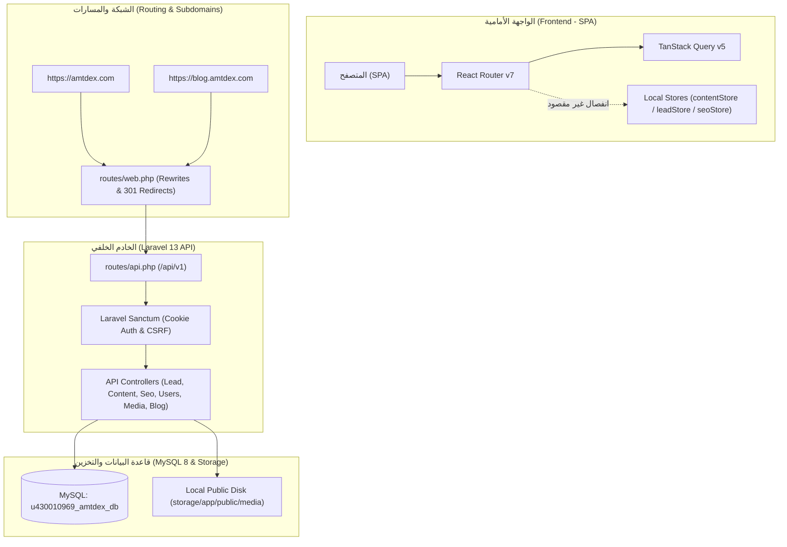

# تقرير الفحص والتدقيق الشامل لجودة النظام (Amtdex System Audit Report)

**تاريخ التدقيق:** 30 أكتوبر 2026  
**المدقق:** Senior Full-Stack Engineer & QA Auditor  
**طبيعة الفحص:** فحص شامل، عميق، وقائم على الأدلة (Read-Only Audit)  
**حالة المستودع:** `main` branch (Laravel 13 + React 19 + MySQL)

---

## 1. الملخص التنفيذي (Executive Summary)

### التقييم العام لجاهزية النظام: **6.5 / 10**

المشروع مبني بهيكل تقني حديث ومتطور (Laravel 13 مع React 19، Tailwind CSS v4، TanStack Query v5، ونظام مدونة متكامل مع SEO احترافي على سب دومين). الواجهات مصممة ومبنية بعناية فائقة وتتبع نظام Tokens دقيق.
ومع ذلك، كشف التدقيق العميق عن **فجوة هيكلية جوهرية** بين طبقة الخادم وقاعدة البيانات من جهة، والواجهة الأمامية من جهة أخرى؛ حيث تعمل صفحات الموقع العامة بشكل شبه منفصل على `localStorage` وبيانات ثابتة بدلاً من استهلاك الـ API، إلى جانب بيانات اعتماد حساسة مكتوبة في الكود كقيم افتراضية، وتضارب في قواعد التحقق (Validation)، وعدد من الأزرار والوظائف المعطلة أو الوهمية (Mock).

### إحصائية المشاكل حسب مستوى الخطورة:

| مستوى الخطورة | العدد | النطاق الأساسي |
| :--- | :---: | :--- |
| 🔴 **حرجة (Critical)** | **3** | كشف بيانات اعتماد في الكود، انفصال الواجهة العامة عن الـ API وقاعدة البيانات، خطأ كلاس غير موجود يهدد بانهيار الـ RSS Feed. |
| 🟠 **عالية (High)** | **7** | تضارب التحقق بين Frontend/Backend، ثغرة Stored XSS محتملة في رفع SVG، تلاعب بعداد المشاهدات، بيانات مشاريع مزيفة، غياب لوحة النشرة البريدية، بيانات إحصائية مضللة في Overview. |
| 🟡 **متوسطة (Medium)** | **14** | نماذج يتيمة وكود ميت (Teams/Legacy)، شاشات لوحة تحكم بدون CRUD (المستخدمين والوسائط)، مسارات sitemap بنطاق خاطئ، غياب Soft Deletes وفهارس قواعد البيانات. |
| 🟢 **منخفضة (Low)** | **4** | غياب معالجة أخطاء الشبكة في بعض النماذج، نقص توثيق OpenAPI، توحيد العملات وأرقام الهواتف. |
| **الإجمالي** | **28 مشكلة مرصودة بالأدلة** | |

### أهم 5 مشاكل تتطلب تدخلاً عاجلاً:
1. **انفصال الواجهات العامة عن قاعدة البيانات (ISSUE-05):** صفحات الخدمات (`/services`) والمشاريع (`/portfolio`) والأسعار (`/pricing`) وتفاصيلها تقرأ من `localStorage` وملفات ثابتة؛ وأي تعديل يجريه الأدمن في لوحة التحكم لا ينعكس إطلاقاً على زوار الموقع.
2. **كشف بيانات اعتماد قاعدة البيانات والـ APP_KEY في الكود (ISSUE-01):** وجود كلمة مرور قاعدة البيانات الحية ومفتاح تشفير التطبيق كقيم افتراضية (fallbacks) داخل ملفات `config/database.php` و `config/app.php`.
3. **تضارب قواعد التحقق (Validation Mismatch) المؤدي لرفض الطلبات (ISSUE-07):** نماذج التواصل وعروض الأسعار تعتبر رقم الهاتف وتفاصيل المشروع اختيارية في الواجهة، بينما يفرضها الخادم كحقول إلزامية، مما يسبب رفض الطلبات بـ 422 دون رسائل مفهومة للمستخدم.
4. **خطأ قاتل كامن في تغذية الـ RSS Feed عند غياب ملخص المقال (ISSUE-06):** استخدام الكلاس `Str::limit` دون عمل `use Illuminate\Support\Str;` في `PublicBlogController`، مما يسقط رابط `/feed` بخطأ 500 في حال عدم تعبئة الملخص.
5. **شاشات لوحة تحكم للقراءة فقط دون إمكانية الإدارة (ISSUE-17 & ISSUE-18):** صفحة المستخدمين تفتقر لأي أزرار للإضافة أو التعديل أو الحذف، وصفحة الوسائط تفتقر لزر حذف أو زر نسخ الرابط، ومحرر المدونة يفتقر لرفع الصور.

---

## 2. نظرة على بنية المشروع (Project Architecture Overview)



### التقنيات المعتمدة:
- **الواجهة الأمامية (Frontend):** React 19.3، React Router 7.18، TanStack React Query 5.105، Tailwind CSS v4، Zod 4.6، Vite 8.3.
- **الخادم الخلفي (Backend):** Laravel 13.17، PHP 8.3، Laravel Sanctum 4.0 للمصادقة عبر الـ Cookies والجلسات، Pest 4.7 للاختبارات.
- **قاعدة البيانات (Database):** MySQL 8 (على خادم Hostinger) تضم 12 جدولاً أساسياً و8 جداول لنظام المدونة.
- **التخزين (Storage):** Laravel Local Public Disk (`storage/app/public/media`) مربوط عبر symlink إلى `public/storage`.
- **معمارية النطاقات:** فصل المدونة على سب دومين `blog.amtdex.com` مع تحويلات 301 ذكية بين النطاقين عبر `routes/web.php` ومكون `Header/Footer`.

---

## 3. المشاكل التفصيلية المدعومة بالأدلة (Detailed Issues)

### 🔴 أولاً: المشاكل الحرجة (Critical Severity)

#### [ISSUE-01] بيانات اعتماد قاعدة بيانات الإنتاج ومفتاح التشفير APP_KEY مكتوبة كقيم افتراضية داخل الكود
- **القسم:** أمان / إعدادات
- **الخطورة:** 🔴 حرجة
- **الوصف الدقيق:** يحتوي ملف إعدادات قاعدة البيانات `config/database.php` على اسم المستخدم وكلمة المرور الحقيقية لقاعدة بيانات الإنتاج في Hostinger كقيمة احتياطية (fallback)، كما يحتوي ملف `config/app.php` على مفتاح تشفير التطبيق `APP_KEY` كقيمة fallback.
- **الدليل:**
  - `config/database.php#L52-L56`:
    ```php
    'database' => env('DB_DATABASE', 'u430010969_amtdex_db'),
    'username' => env('DB_USERNAME', 'u430010969_amtdex_usr'),
    'password' => (in_array(env('DB_PASSWORD'), ['Amtdex', null, ''], true))
        ? 'Amtdex#Db2026!Sec'
        : env('DB_PASSWORD', 'Amtdex#Db2026!Sec'),
    ```
  - `config/app.php#L100`:
    ```php
    'key' => env('APP_KEY', 'base64:AGUDfr1IZuLdVIqcj2EEugV56H6M898hSgWJbyBi6Eg='),
    ```
- **التأثير:** كشف فوري لبيانات الدخول لقاعدة بيانات الاستضافة ومفتاح فك تشفير الجلسات عند مشاركة الكود أو دفعه إلى GitHub.
- **الحل المقترح:** إزالة أي كلمات مرور أو مفاتيح من ملفات `config/` واستبدالها حصراً بـ `env('DB_PASSWORD')` و `env('APP_KEY')`، مع الالتزام بوضعها فقط في ملف `.env` غير المتتبع في git.

---

#### [ISSUE-05] الواجهات العامة للموقع تقرأ البيانات من `localStorage` وملفات ثابتة بدلاً من الـ API وقاعدة البيانات
- **القسم:** واجهة / معمارية / توافق
- **الخطورة:** 🔴 حرجة
- **الوصف الدقيق:** على الرغم من بناء Endpoints متكاملة في الخادم الخلفي (`GET /api/v1/services` و `GET /api/v1/projects`)، فإن صفحات الموقع العامة تستورد دوال `useServices()` و `useProjects()` من `resources/js/lib/contentStore.ts` التي تقرأ من `localStorage` مع الرجوع للملفات الثابتة `data/services.ts` و `data/projects.ts`، بينما صفحة طلب عرض السعر تستورد البيانات الثابتة مباشرة.
- **الدليل:**
  - `resources/js/pages/Home/HomePage.tsx#L11,L21`:
    ```tsx
    import { useServices } from "@/lib/contentStore"
    const services = useServices()
    ```
  - `resources/js/pages/Services/ServicesPage.tsx#L3,L6`:
    ```tsx
    import { useServices } from "@/lib/contentStore"
    const SERVICES = useServices()
    ```
  - `resources/js/pages/Services/ServiceDetailPage.tsx#L3,L7`:
    ```tsx
    import { useServices } from "@/lib/contentStore"
    ```
  - `resources/js/pages/Portfolio/PortfolioPage.tsx#L4,L7`:
    ```tsx
    import { useProjects } from "@/lib/contentStore"
    ```
  - `resources/js/pages/Portfolio/PortfolioDetailPage.tsx#L3,L7`:
    ```tsx
    import { useProjects } from "@/lib/contentStore"
    ```
  - `resources/js/pages/Quote/QuotePage.tsx#L7,L61`:
    ```tsx
    import { SERVICES } from "@/data/services"
    ```
- **التأثير:** لوحة التحكم تعمل على تعديل قاعدة البيانات الحقيقية عبر الـ API، ولكن زوار الموقع يشاهدون دائماً بيانات قديمة من ملفات الكود أو متصفحهم، مما يجعل تعديلات لوحة التحكم بلا أي أثر فعلي على الموقع.
- **الحل المقترح:** استبدال استدعاءات `useServices` و `useProjects` بدوال TanStack Query المتوفرة أصلاً في `resources/js/lib/queries.ts` (`useServicesQuery` و `useProjectsQuery`) مع تفعيل الـ cache والـ fallback.

---

#### [ISSUE-06] استدعاء كلاس غير مستورد `Str::limit` في متحكم المدونة العام يهدد بانهيار الـ RSS Feed بخطأ Fatal Error
- **القسم:** API / مدونة
- **الخطورة:** 🔴 حرجة
- **الوصف الدقيق:** في دالة توليد موجز الـ RSS (`feed()`) داخل `PublicBlogController`، يتم استدعاء `Str::limit(...)` في سطر توليد وصف المقال، ولكن الكلاس `Illuminate\Support\Str` غير مستورد في ترويسة الملف.
- **الدليل:**
  - ترويسة الملف `app/Http/Controllers/Api/V1/Blog/PublicBlogController.php#L1-L15` تخلو من `use Illuminate\Support\Str;`.
  - السطر `app/Http/Controllers/Api/V1/Blog/PublicBlogController.php#L306`:
    ```php
    $xml .= '<description><![CDATA[' . ($post->summary ?: Str::limit(strip_tags($post->content), 250)) . ']]></description>';
    ```
- **التأثير:** بمجرد قيام الكاتب بنشر مقال بدون تعبئة حقل الملخص (`summary`)، فإن زيارة الرابط `https://blog.amtdex.com/feed` ستنهار فوراً بخطأ فادح: `Class "App\Http\Controllers\Api\V1\Blog\Str" not found` (HTTP 500).
- **الحل المقترح:** إضافة سطر الاستيراد في أعلى الملف:
  ```php
  use Illuminate\Support\Str;
  ```

---

### 🟠 ثانياً: المشاكل عالية الخطورة (High Severity)

#### [ISSUE-07] تضارب قواعد التحقق (Validation Mismatch) بين الواجهة والخادم في نماذج التواصل وعروض الأسعار
- **القسم:** API / واجهة
- **الخطورة:** 🟠 عالية
- **الوصف الدقيق:** في الواجهة الأمامية (`resources/js/lib/schemas.ts`)، تم تعريف حقل الهاتف `phone` وحقل تفاصيل المشروع `details` كحقول اختيارية (`optional`)، بينما في الخادم الخلفي (`StoreContactRequest` و `StoreQuoteRequest`) تم تعريفهما كحقول إلزامية (`required`) مع اشتراط نمط تعبير نمطي (Regex) يبدأ بـ 7 أرقام على الأقل.
- **الدليل:**
  - واجهة التواصل `resources/js/lib/schemas.ts#L10`:
    ```ts
    phone: z.string().trim().optional(),
    ```
    مقابل الخادم الخلفي `app/Http/Requests/Api/V1/StoreContactRequest.php#L19`:
    ```php
    'phone' => ['required', 'regex:/^[0-9+\s-]{7,20}$/'],
    ```
  - واجهة عروض الأسعار `resources/js/lib/schemas.ts#L25-L26`:
    ```ts
    phone: z.string().trim().optional(),
    details: z.string().trim().optional(),
    ```
    مقابل الخادم الخلفي `app/Http/Requests/Api/V1/StoreQuoteRequest.php#L22-L23`:
    ```php
    'phone' => ['required', 'regex:/^[0-9+\s-]{7,20}$/'],
    'details' => ['required', 'string', 'min:10', 'max:3000'],
    ```
- **التأثير:** المستخدم في الواجهة يرى الحقل اختيارياً ويضغط إرسال، فيمر الفحص في المتصفح ويرفضه الخادم بـ HTTP 422، وتظل واجهة المستخدم معلقة.
- **الحل المقترح:** توحيد القواعد بجعل `phone` و `details` إلزاميين في الواجهة عبر Zod مع وضع رسائل خطأ عربية واضحة، أو جعلهما اختياريين في الخادم إذا رغب العمل بذلك.

---

#### [ISSUE-02] ثغرة Stored XSS محتملة ناتجة عن رفع ملفات SVG دون فحص أمني للمحتوى
- **القسم:** أمان / رفع ملفات
- **الخطورة:** 🟠 عالية
- **الوصف الدقيق:** يسمح متحكم الوسائط `MediaController` برفع ملفات بامتداد `svg` ويقوم بتخزينها مباشرة في القرص العام (`public`) وتوفير رابطها، دون تنظيف محتواها من وسوم `<script>` أو معالجات الأحداث التفاعلية (`onload`, `onerror`).
- **الدليل:** `app/Http/Controllers/Api/V1/MediaController.php#L45,L59-L60`:
  ```php
  'mimes:jpeg,jpg,png,webp,svg,pdf',
  ...
  $path = $file->storeAs('media', $safeName, 'public');
  ```
- **التأثير:** إمكانية قيام مستخدم يملك دور `editor` أو أي حساب مخترق برفع ملف SVG يحتوي كود جافاسكريبت، وعند فتح الرابط في المتصفح يتم تنفيذ الكود في نطاق الموقع (Cross-Site Scripting).
- **الحل المقترح:** تنقية ملفات الـ SVG قبل حفظها باستخدام مكتبة تنقية مثل `enshrined/svg-sanitize`، أو منع رفع الـ SVG لغير الـ Super Admin وتعيين ترويسة `Content-Disposition: attachment` أو ترويسات `Content-Security-Policy` صارمة لملفات الوسائط.

---

#### [ISSUE-03] عداد مشاهدات المقالات غير محمي ومفتوح للتلاعب وهجمات إنهاك الخادم
- **القسم:** أداء / أمان
- **الخطورة:** 🟠 عالية
- **الوصف الدقيق:** دالة استعراض المقال `post($slug)` في `PublicBlogController` تنفذ عملية زيادة مباشرة لعدد المشاهدات (`$post->increment('views_count')`) مع كل طلب GET وبدون أي Rate Limiting أو تحقق من الجلسة أو الكوكيز.
- **الدليل:** `app/Http/Controllers/Api/V1/Blog/PublicBlogController.php#L98`:
  ```php
  // Increment views count safely
  $post->increment('views_count');
  ```
- **التأثير:** يستطيع أي زائر أو سكريبت بسيط إرسال آلاف الطلبات في ثوانٍ لتضخيم المشاهدات إلى ملايين وتوليد ضغط كبير على قاعدة البيانات (Row Lock Contention).
- **الحل المقترح:** التحقق من جلسة المستخدم أو تخزين مفتاح مؤقت في الـ Cache (`Cache::has("viewed_post_{$post->id}_{$ip}")`) بحيث لا تُحتسب المشاهدة للمستخدم نفسه إلا مرة واحدة كل 1-2 ساعة.

---

#### [ISSUE-08] بيانات مشتركي النشرة البريدية معزولة ومحرومة من العرض أو التصدير في لوحة التحكم
- **القسم:** لوحة تحكم / قاعدة بيانات
- **الخطورة:** 🟠 عالية
- **الوصف الدقيق:** يتم تخزين اشتراكات النشرة البريدية عبر `NewsletterController` في جدول مستقل تماماً يسمى `newsletter_subscribers`، في حين أن لوحة التحكم تعرض الطلبات من جدول `leads`، وفلتر `newsletter` الموجود في صفحة `LeadsPage` لا يجد أي سجلات لأنها غير مخزنة في هذا الجدول.
- **الدليل:**
  - `app/Http/Controllers/Api/V1/NewsletterController.php#L17`:
    ```php
    $subscriber = NewsletterSubscriber::firstOrCreate(['email' => $request->email], ...);
    ```
  - `resources/js/pages/Dashboard/Leads/index.tsx#L75`:
    ```tsx
    {["الكل", "contact", "quote", "newsletter"].map((s) => ...)}
    ```
- **التأثير:** لا يوجد أي مكان في لوحة التحكم يتيح للمدير رؤية الإيميلات المشتركة في النشرة أو تصديرها لحملات البريد، وفلتر النشرة في صفحة الطلبات يظهر دائماً فارغاً.
- **الحل المقترح:** إما إضافة تاب مخصص في لوحة التحكم لإدارة `newsletter_subscribers` وتصديرهم CSV، أو دمج الاشتراكات كنوع طلب (`source = 'newsletter'`) داخل جدول `leads`.

---

#### [ISSUE-09] تفاصيل المشاريع في الواجهة تحتوي على نصوص وبيانات إحصائية مزيفة وثابتة لا مصدر لها في قاعدة البيانات
- **القسم:** واجهة / قاعدة بيانات
- **الخطورة:** 🟠 عالية
- **الوصف الدقيق:** صفحة تفاصيل المشروع `PortfolioDetailPage` تعرض أقساماً تفصيلية رئيسية ("التحدي"، "ما بنيناه"، "النتيجة"، "المدة"، "الفريق") بنصوص وأرقام ثابتة (Hardcoded) متطابقة لجميع المشاريع، وجدول `projects` لا يحتوي أصلاً على أعمدة لتخزين هذه البيانات.
- **الدليل:** `resources/js/pages/Portfolio/PortfolioDetailPage.tsx#L45-L93`:
  - السطر 47: نص التحدي ثابت: `"العميل احتاج منصة سريعة، آمنة، وقابلة للتوسع..."`.
  - الأسطر 51-56: مصفوفة "ما بنيناه" ثابتة: `["واجهة سريعة (LCP < 1.2s)", "لوحة تحكم Filament...", ...]`.
  - الأسطر 60-69: أرقام النتيجة ثابتة: `+40% أسرع`، `2.1× تحويل أعلى`، `99.9% توفر`.
  - الأسطر 87-91: المدة ثابتة: `"8 أسابيع"`، والفريق: `"5 أشخاص"`.
- **التأثير:** أي مشروع جديد يضيفه الأدمن في لوحة التحكم سيظهر بنفس الأرقام والنصوص المزيفة للمشاريع الأخرى، ولا توجد أي حقول في لوحة التحكم أو قاعدة البيانات لتخصيص هذه القيم لكل مشروع.
- **الحل المقترح:** إضافة حقول مرنة في جدول `projects` (مثل `challenge: text`، `deliverables: json`، `metrics: json`، `duration: string`، `team_size: string`) وتحديث شاشة الإدخال في اللوحة لعرضها.

---

#### [ISSUE-10] إحصائيات لوحة التحكم في صفحة Overview تحتوي على قيمة مزيفة غير حقيقية `max($projectsCount, 12)`
- **القسم:** لوحة تحكم / API
- **الخطورة:** 🟠 عالية
- **الوصف الدقيق:** في متحكم إحصائيات اللوحة `DashboardOverviewController`، يتم حساب عدد المشاريع النشطة عبر دالة `max($projectsCount, 12)`.
- **الدليل:** `app/Http/Controllers/Api/V1/DashboardOverviewController.php#L30-L33`:
  ```php
  'activeProjects' => [
      'value' => max($projectsCount, 12),
      'sub' => 'مشاريع معتمدة',
  ],
  ```
- **التأثير:** لو كان لدى النظام 4 مشاريع فقط في قاعدة البيانات، ستعرض لوحة تحكم الإدارة دائماً 12 مشروعاً! هذا تضليل للوحة التحكم الإدارية.
- **الحل المقترح:** إرجاع القيمة الحقيقية مباشرة: `'value' => $projectsCount`.

---

### 🟡 ثالثاً: المشاكل متوسطة الخطورة (Medium Severity)

#### [ISSUE-11] نموذج `User` يستخدم Trait لفرق العمل (`HasTeams`) وحقل `current_team_id` غير موجودين في قاعدة البيانات
- **القسم:** قاعدة بيانات / Models
- **الخطورة:** 🟡 متوسطة
- **الوصف الدقيق:** يحتوي نموذج `User` على السطر `use HasTeams` وحقل `current_team_id` في مصفوفة الـ `fillable`، بالإضافة إلى دوال علاقات `teams()` و `currentTeam()` الموروثة من التريت، في حين أن جدول `users` في الـ Migrations لا يحتوي على عمود `current_team_id`، وجداول `teams` غير موجودة أصلاً في قاعدة البيانات.
- **الدليل:** `app/Models/User.php#L5,L32,L40,L45` مقابل `database/migrations/0001_01_01_000000_create_users_table.php`.
- **التأثير:** استدعاء أي من خواص فرق العمل الموروثة على كائن المستخدم سيؤدي إلى SQL Exception فورية: `Column not found: Unknown column current_team_id`.
- **الحل المقترح:** تنظيف نموذج `User` بحذف `HasTeams` وحذف `current_team_id` من `$fillable` بما يتطابق مع البنية الفعلية للنظام.

---

#### [ISSUE-12] وجود كود ميت ونماذج ومتحكمات غير مستخدمة خاصة بحزم سابقة (`Team`, `Membership`, `TeamInvitation`)
- **القسم:** جودة الكود / صيانة
- **الخطورة:** 🟡 متوسطة
- **الوصف الدقيق:** توجد نماذج كاملة (`Team.php`, `Membership.php`, `TeamInvitation.php`) ومتحكمات كاملة في `app/Http/Controllers/Teams/` و `routes/settings.php` وميدلوير `EnsureTeamMembership` متبقية من حزم سابقة دون أن يتم تسجيل مساراتها في `bootstrap/app.php` ودون وجود جداول لها.
- **الدليل:**
  - `app/Models/Team.php`
  - `app/Models/Membership.php`
  - `app/Models/TeamInvitation.php`
  - `app/Http/Controllers/Teams/TeamController.php`
  - `routes/settings.php`
- **التأثير:** زيادة حجم الكود، تضليل المطورين والمدققين، وإعطاء انطباع بوجود ميزة غير مكتملة وغير قابلة للتشغيل.
- **الحل المقترح:** أرشفة أو حذف هذه الملفات ومساراتها غير المفعلة لتنظيف المستودع.

---

#### [ISSUE-13] عدم تطابق الأدوار: عجز الأدمن عن إضافة أو تعيين كاتب مقالات (Author) من لوحة المستخدمين
- **القسم:** لوحة تحكم / صلاحيات
- **الخطورة:** 🟡 متوسطة
- **الوصف الدقيق:** نظام المدونة يعتمد دور `author` (كما هو محدد في `BlogPost` وميدلوير `role:admin,editor,author` ودالة `User::isAuthor()`). ومع ذلك، فإن متحكم إدارة المستخدمين `UserController` يقيد الأدوار المسموح بإنشائها وتعديلها في قائمة محصورة بـ `['admin', 'editor', 'viewer']` فقط.
- **الدليل:** `app/Http/Controllers/Api/V1/UserController.php#L44,L79`:
  ```php
  'role' => ['required', Rule::in(['admin', 'editor', 'viewer'])],
  ```
- **التأثير:** الأدمن عاجز برمجياً عن إنشاء حساب كاتب وتعيين دور `author` له من خلال الـ API أو لوحة التحكم.
- **الحل المقترح:** إضافة `'author'` لقائمة الأدوار المعتمدة في `UserController.php`: `Rule::in(['admin', 'editor', 'author', 'viewer'])`.

---

#### [ISSUE-14] جدول سجل العمليات `audit_logs` يخزن اسم المستخدم كنص مجرد دون علاقة برمجية بجدول `users`
- **القسم:** قاعدة بيانات / أمان
- **الخطورة:** 🟡 متوسطة
- **الوصف الدقيق:** عمود `user` في جدول `audit_logs` معرف كـ `string` بسيط ويتم ملؤه ببريد المستخدم كنص، دون وجود مفتاح أجنبي `user_id` يربطه بجدول `users`.
- **الدليل:** `database/migrations/2026_10_29_162217_create_audit_logs_table.php#L16`:
  ```php
  $table->string('user');
  ```
- **التأثير:** صعوبة بناء استعلامات تتبع دقيقة حسب معرّف المستخدم (ID)، وفقدان الربط إذا تغير البريد الإلكتروني للمستخدم مستقبلاً.
- **الحل المقترح:** إضافة عمود `foreignId('user_id')->nullable()->nullOnDelete()` لتمكين الربط العلائقي الأوثق مع الإبقاء على نص البريد كنسخة أرشيفية.

---

#### [ISSUE-15] غياب ميزة الحذف اللطيف (Soft Deletes) عن الكيانات الأساسية للنظام
- **القسم:** قاعدة بيانات
- **الخطورة:** 🟡 متوسطة
- **الوصف الدقيق:** الجداول الحيوية (`leads`, `services`, `projects`, `blog_posts`, `blog_categories`, `blog_tags`, `users`, `media`) لا تستخدم ميزة `SoftDeletes`.
- **الدليل:** استعراض الموديلات (`app/Models/*.php`) و Migrations يؤكد غياب عمود `deleted_at` وغياب تريت `SoftDeletes`.
- **التأثير:** عند قيام أي مدير بحذف مقال أو مشروع أو طلب عميل عن طريق الخطأ، يتم حذفه نهائياً من قاعدة البيانات (Permanent Deletion) دون أي فرصة لاستعادته، ومقالات المدونة يترتب على حذفها حذف جماعي متتالي (Cascade) لجميع تعليقاتها وسجل مراجعاتها.
- **الحل المقترح:** إضافة `SoftDeletes` لجداول `blog_posts`, `projects`, `services`, `leads`, `users`.

---

#### [ISSUE-16] نقص فهارس قواعد البيانات (Missing Database Indexes) على حقول البحث والترتيب
- **القسم:** قاعدة بيانات / أداء
- **الخطورة:** 🟡 متوسطة
- **الوصف الدقيق:**
  - جدول `services`: يُستعلم عنه دائماً بـ `where('is_published', true)->orderBy('sort_order')` دون وجود فهارس على هذه الحقول.
  - جدول `projects`: يُستعلم عنه بـ `where('is_published', true)->orderBy('sort_order')` ويُفلتر بحسب `cat` دون وجود أي فهارس.
  - جدول `blog_posts`: البحث النصي في `scopeSearch` يستخدم `like %term%` على أعمدة `title, summary, content, focus_keyword` دون وجود فهرس FullText Index.
- **الدليل:**
  - `database/migrations/2026_10_29_162212_create_services_table.php`
  - `database/migrations/2026_10_29_162213_create_projects_table.php`
  - `app/Models/BlogPost.php#L116-L128`
- **التأثير:** بطء ملحوظ في استعلامات البحث والتصفية مع تزايد حجم البيانات والمقالات.
- **الحل المقترح:** إنشاء Migration لإضافة الفهارس المركبة المناسبة وفهرس FullText على المقالات.

---

#### [ISSUE-17] صفحة إدارة المستخدمين `UsersPage` في اللوحة للعرض فقط وتفتقر لعمليات الإضافة والتعديل والحذف
- **القسم:** لوحة تحكم
- **الخطورة:** 🟡 متوسطة
- **الوصف الدقيق:** توفر واجهة البرمجة في الخادم الخلفي (`UserController`) وظائف كاملة: إنشاء مستخدم (`store`)، تعديل مستخدم وكلمة مروره (`update`)، وحذف مستخدم (`destroy`). إلا أن صفحة `resources/js/pages/Dashboard/Users/index.tsx` عبارة عن جدول عرض فقط (Read-Only)، ولا تحتوي على أي أزرار أو نوافذ منبثقة لإضافة مستخدم جديد أو تعديل دور أو حذف مستخدم.
- **الدليل:** `resources/js/pages/Dashboard/Users/index.tsx#L30-L65`.
- **التأثير:** المدير لا يستطيع إدارة الفريق من لوحة التحكم، ويضطر لتنفيذ ذلك يدوياً عبر قاعدة البيانات أو سطر أوامر Tinker.
- **الحل المقترح:** إضافة أزرار ونموذج منبثق (Modal) لإنشاء وتعديل وحذف المستخدمين وتغيير أدوارهم وكلمات مرورهم.

---

#### [ISSUE-18] صفحة الوسائط `MediaPage` تفتقر لأزرار حذف الملفات ونسخ روابطها
- **القسم:** لوحة تحكم
- **الخطورة:** 🟡 متوسطة
- **الوصف الدقيق:** توفر الـ API عملية حذف وسائط كاملة في `MediaController@destroy`، إلا أن بطاقات الملفات في `resources/js/pages/Dashboard/Media/index.tsx` تعرض فقط أيقونة الملف واسمه وحجمه دون أي زر لنسخ رابط الملف (Copy URL) لاستخدامه، ودون أي زر لحذف الملف القديم.
- **الدليل:** `resources/js/pages/Dashboard/Media/index.tsx#L81-L93`.
- **التأثير:** عدم إمكانية استخدام الروابط بسهولة أو تنظيف الملفات غير المرغوبة من واجهة المستخدم.
- **الحل المقترح:** إضافة زر "نسخ الرابط" ينقل الرابط للحافظة، وزر "حذف" يستدعي `useDeleteMediaMutation`.

---

#### [ISSUE-19] محرر مقالات المدونة يفتقر لإمكانية رفع الصور مباشرة لغلاف المقال أو محتواه
- **القسم:** لوحة تحكم / مدونة
- **الخطورة:** 🟡 متوسطة
- **الوصف الدقيق:** حقل صورة الغلاف (`cover_image`) في نافذة تحرير المقال عبارة عن خانة إدخال نصية بسيطة يدوية تقبل رابط URL، ولا يوجد زر لرفع الصورة من الجهاز أو اختيارها من مكتبة الوسائط، كما أن المحرر يفتقر لزر رفع صور داخل نصوص المقال.
- **الدليل:** `resources/js/pages/Dashboard/Blog/DashboardBlogPage.tsx#L506-L507`.
- **التأثير:** تجربة تحرير محتوى شاقة تجبر المحرر على رفع الصورة في مكان آخر ونسخ رابطها يدوياً ولصقه.
- **الحل المقترح:** ربط حقل صورة الغلاف ومحرر النصوص بزر رفع مباشر يتصل بـ `MediaController@upload`.

---

#### [ISSUE-20] وجود صفحة لوحة التحكم القديمة `DashboardPage.tsx` كملف ميت ومسار تجريبي في التطبيق
- **القسم:** جودة الكود
- **الخطورة:** 🟡 متوسطة
- **الوصف الدقيق:** يوجد ملف قديم يسمى `DashboardPage.tsx` بحجم 291 سطراً يحتوي على شاشات وهمية للمشاريع والفواتير وتنبيه بأن اللوحة "وضع معاينة Frontend Only"، وهو مرتبط بمسار `/dashboard/legacy` في `App.tsx`.
- **الدليل:** `resources/js/pages/Dashboard/DashboardPage.tsx` و `resources/js/components/App.tsx#L130`.
- **التأثير:** بقاء كود تجريبي قديم لا علاقة له باللوحة الحقيقية.
- **الحل المقترح:** حذف هذا الملف ومساره نهائياً.

---

#### [ISSUE-21] ملفات `public/robots.txt` و `public/sitemap.xml` تحتوي على نطاق قديم وغير صالح `amtdex.ye`
- **القسم:** SEO
- **الخطورة:** 🟡 متوسطة
- **الوصف الدقيق:** الروابط المكتوبة في ملف خريطة الموقع الثابت `public/sitemap.xml` وملف الروبوت `public/robots.txt` تشير جميعها إلى النطاق اليمني القديم `https://amtdex.ye/` بدلاً من نطاق الموقع الفعلي المعتمد `https://amtdex.com/`.
- **الدليل:**
  - `public/robots.txt#L10`: `Sitemap: https://amtdex.ye/sitemap.xml`
  - `public/sitemap.xml#L4,L9,L14,L19,L24,L29...`: جميع الروابط تبدأ بـ `https://amtdex.ye/...`
- **التأثير:** أخطاء فادحة في الزحف والفهرسة لدى محركات البحث، وعدم فهرسة صفحات الموقع الحقيقية.
- **الحل المقترح:** تحويل توليد خريطة الموقع للموقع الرئيسي إلى مسار ديناميكي يقرأ النطاق من `config('app.url')`، وتصحيح الملفات الثابتة.

---

#### [ISSUE-22] روابط Canonical في الواجهة تعتمد على كامل رابط المتصفح متضمناً بارامترات التتبع الإعلاني
- **القسم:** SEO
- **الخطورة:** 🟡 متوسطة
- **الوصف الدقيق:** في مكون `Seo.tsx`، عند عدم تمرير رابط `canonical` صريح، يتم الاعتماد تلقائياً على `window.location.href` بكامل محتواه متضمناً بارامترات التتبع مثل `?ref=...`, `?utm_source=...`, `?fbclid=...`.
- **الدليل:** `resources/js/components/Seo.tsx#L56`:
  ```tsx
  const url = canonical ?? (typeof window !== "undefined" ? window.location.href : DEFAULT_SITE)
  ```
- **التأثير:** تكرار المحتوى وتشتت قوة الصفحة لدى محركات البحث عند دخول المستخدمين عبر حملات إعلانية مختلفة.
- **الحل المقترح:** تنقية الرابط من الـ query parameters في الرابط المعياري عبر `window.location.origin + window.location.pathname`.

---

#### [ISSUE-23] نطاق الجلسات `SESSION_DOMAIN` غير محدد مما يعطل بقاء تسجيل الدخول بين النطاق والسب دومين
- **القسم:** مصادقة / تكامل
- **الخطورة:** 🟡 متوسطة
- **الوصف الدقيق:** في ملف البيئة `.env`، تم تعيين `SESSION_DOMAIN=null`، مما يعني أن كوكيز الجلسة لا تشمل النطاقات الفرعية (Subdomains).
- **الدليل:** `.env#L25`:
  ```env
  SESSION_DOMAIN=null
  ```
- **التأثير:** عند تسجيل دخول الأدمن على الموقع الرئيسي والانتقال إلى لوحة التحكم أو المدونة على السب دومين، لا تنتقل الجلسة تلقائياً ويتطلب الأمر إعادة تسجيل الدخول.
- **الحل المقترح:** ضبط `SESSION_DOMAIN=.amtdex.com` في بيئة الإنتاج ليتم إرسال كوكيز الجلسة لجميع النطاقات الفرعية.

---

#### [ISSUE-24] تشتت وتضارب بيانات التواصل والعملات بين اليمن والسعودية
- **القسم:** هوية / محتوى
- **الخطورة:** 🟡 متوسطة
- **الوصف الدقيق:** الموقع يعرّف الشركة بأنها "شركة يمنية في صنعاء" وتظهر أرقام يمنية `+967 7xx xxx xxx` في `SiteSetting`، وفي المقابل تظهر أرقام سعودية `+966 50 000 0000` ورابط واتساب سعودي في الفوتر ونماذج التواصل، وعملات الفوترة بالريال السعودي، وخيارات الدفع تتضمن (مدى، STC Pay، تابي وتمارا).
- **الدليل:**
  - الفوتر `resources/js/components/layout/Footer.tsx#L34-L35`
  - صفحة التواصل `resources/js/pages/Contact/ContactPage.tsx#L45`
  - الإعدادات `app/Models/SiteSetting.php#L27`
- **التأثير:** تشويش هوية النشاط ومصداقية وسائل الاتصال لدى العملاء والزوار.
- **الحل المقترح:** توحيد بيانات الاتصال الرسمية وسحبها حصراً من جدول `site_settings` في قاعدة البيانات بدلاً من كتابتها في نصوص الواجهات.

---

### 🟢 رابعاً: المشاكل منخفضة الخطورة (Low Severity)

#### [ISSUE-25] زر التبديل بين الفوترة الشهرية والسنوية في صفحة الأسعار لا يغيّر الأسعار المعروضة
- **القسم:** واجهة / تجربة مستخدم
- **الخطورة:** 🟢 منخفضة
- **الوصف الدقيق:** في صفحة `PricingPage.tsx`، يؤدي النقر على "سنوي (خصم 20%)" إلى تغيير قيمة الـ state `billing`، لكن أسعار الباقات تظل ثابتة كما هي دون تطبيق الخصم أو تغيير الأرقام. كما أن زر "اطلب تسعير مخصص" يطلق تنبيهاً تجريبياً (Mock Toast).
- **الدليل:** `resources/js/pages/Pricing/PricingPage.tsx#L16-L34,L55`.
- **التأثير:** إحساس الزائر بأن الموقع تجريبي وغير تفاعلي.
- **الحل المقترح:** احتساب خصم الـ 20% برمجياً وعرض السعر المخفض عند اختيار الفوترة السنوية، وربط زر التسعير بصفحة `/quote`.

---

#### [ISSUE-26] غياب كتل معالجة الأخطاء (try/catch) حول استدعاءات نماذج التواصل وعروض الأسعار
- **القسم:** واجهة / تجربة مستخدم
- **الخطورة:** 🟢 منخفضة
- **الوصف الدقيق:** في دوال `handleSubmit` في `ContactPage.tsx` و `submit` في `QuotePage.tsx`، يتم استدعاء الـ API بـ `await API.contact(fd)` دون إحاطتها بـ `try/catch/finally`.
- **الدليل:** `resources/js/pages/Contact/ContactPage.tsx#L23-L27` و `resources/js/pages/Quote/QuotePage.tsx#L31`.
- **التأثير:** في حال انقطاع الاتصال أو رد الخادم بخطأ، يظل زر الإرسال معطلاً في وضع "جار الإرسال..." دون إعلام المستخدم بحدوث خطأ.
- **الحل المقترح:** إحاطة الاستدعاء بـ `try/catch` وتعيين `setSending(false)` في كتلة `finally`.

---

#### [ISSUE-27] غياب كامل لاختبارات نظام المدونة والتحويلات الآلية في الخادم الخلفي
- **القسم:** اختبارات / جودة
- **الخطورة:** 🟢 منخفضة
- **الوصف الدقيق:** مجلد اختبارات الخادم الخلفي `tests/Feature/` يحتوي فقط على اختبار واحد للموقع العام (`ApiEndpointsTest.php`)، ولا يوجد أي اختبار آلي لـ `AdminBlogController`، `PublicBlogController`، توليد الـ RSS، خريطة الموقع، أو التحويلات 301.
- **الدليل:** استعراض مجلد `tests/Feature/`.
- **التأثير:** غياب شبكة الأمان لاكتشاف أي أخطاء تراجع (Regression) في وظائف المدونة أثناء التحديثات.
- **الحل المقترح:** إضافة ملف اختبارات `tests/Feature/BlogSystemTest.php` يغطي دورة حياة المقال والتصفية والصلاحيات.

---

#### [ISSUE-28] غياب توثيق مسارات نظام المدونة في ملف `openapi.yaml`
- **القسم:** توثيق
- **الخطورة:** 🟢 منخفضة
- **الوصف الدقيق:** ملف `openapi.yaml` الموجود في جذر المشروع يوثق المسارات الأصلية القديمة فقط ولا يحتوي على أي مسار من مسارات الـ Blog API العامة والإدارية.
- **الدليل:** البحث عن `blog` في `openapi.yaml` يرجع 0 نتائج.
- **التأثير:** نقص التوثيق البرمجي عند تسليم المشروع أو تكامل أطراف خارجية.
- **الحل المقترح:** تحديث ملف المواصفات ليتضمن Schemas ومسارات المدونة.

---

## 4. جدول مقارنة ومطابقة الحقول بين الطبقات (Field Comparison Matrix)

يوضح الجدول التالي التوازن والتطابق بين **قاعدة البيانات (DB)**، **لوحة التحكم (Dashboard)**، و**الواجهة العامة (Frontend)**:

| الحقل / الكيان | موجود في القاعدة؟ | موجود في اللوحة؟ | موجود في الواجهة؟ | الملاحظات والخلل المرصود |
| :--- | :---: | :---: | :---: | :--- |
| **المشاريع: العنوان والعميل والموجز** | ✅ نعم (`projects`) | ✅ نعم | ✅ نعم | متطابق في الهيكل العام. |
| **المشاريع: التحدي (Challenge)** | ❌ لا يوجد حقل | ❌ غير موجود | ⚠️ نص ثابت مزيف | نص ثابت مكرر لجميع المشاريع في `PortfolioDetailPage`. |
| **المشاريع: ما بنيناه (Deliverables)** | ❌ لا يوجد حقل | ❌ غير موجود | ⚠️ نصوص ثابتة | مصفوفة ثابتة مكررة لكل المشاريع. |
| **المشاريع: النتائج والإحصائيات (Metrics)** | ❌ لا يوجد حقل | ❌ غير موجود | ⚠️ أرقام ثابتة | أرقام ثابتة (+40%، 2.1x) مكررة لكل المشاريع. |
| **المشاريع: المدة وفريق العمل** | ❌ لا يوجد حقل | ❌ غير موجود | ⚠️ نصوص ثابتة | 8 أسابيع و 5 أشخاص ثابتة لكل المشاريع. |
| **الخدمات: الأيقونة والعنوان والتفاصيل** | ✅ نعم (`services`) | ✅ نعم | ⚠️ تقرأ من localStorage | لا تتأثر الواجهة بتعديلات اللوحة بسبب القراءة من local store. |
| **الطلبات: الاسم والبريد والرسالة** | ✅ نعم (`leads`) | ✅ نعم | ✅ نعم | متطابق. |
| **الطلبات: التحقق من الهاتف** | ✅ إلزامي (DB/Backend) | ✅ نعم | ⚠️ اختياري (Zod) | تضارب في الفحص يتسبب في رفض الطلبات. |
| **النشرة البريدية: الإيميلات المشتركة** | ✅ نعم (`newsletter_subscribers`) | ❌ غير معروض | ✅ نعم (Form) | الإيميلات تُحفظ في القاعدة دون أي شاشة لعرضها في اللوحة. |
| **المستخدمون: إنشاء وتعديل وحذف** | ✅ نعم (`users`) | ❌ اللوحة للعرض فقط | ❌ غير مطلوب | لوحة المستخدمين للقراءة فقط وتفتقر لأزرار CRUD. |
| **المستخدمون: دور كاتب المقالات (Author)** | ✅ مدعوم بالـ Model | ❌ ممنوع بالـ Controller | ❌ غير معروض | الـ Validator يمنع دور `author` ويحصره في 3 أدوار. |
| **الوسائط: زر حذف الملف ونسخ الرابط** | ✅ مدعوم بالـ API | ❌ غير موجود بالواجهة | ❌ غير مطلوب | شاشة الوسائط تفتقر لأزرار الحذف ونسخ الروابط. |
| **المدونة: رفع صورة الغلاف والصور** | ✅ تخزين بالروابط | ⚠️ حقل رابط نصي فقط | ✅ نعم | لا يوجد زر رفع صور في محرر المدونة. |
| **إعدادات الموقع: وسائل التواصل والعناوين** | ❌ غير موجودة في `SiteSetting` | ❌ غير قابلة للتعديل | ⚠️ نصوص ثابتة | `site_settings` يحتوي فقط على 3 حقول (الاسم، البريد، الهاتف). |
| **الأسعار: الباقات والمميزات** | ❌ لا يوجد جدول | ❌ لا توجد شاشة إدارة | ⚠️ ملف ثابت `pricing.ts` | الأسعار ثابتة في الكود وغير قابلة للإدارة. |
| **آراء العملاء (Testimonials)** | ❌ لا يوجد جدول | ❌ لا توجد شاشة إدارة | ⚠️ ملف ثابت `site.ts` | نصوص ثابتة في كود الواجهة. |
| **أعضاء الفريق (Team Members)** | ❌ لا يوجد جدول | ❌ لا توجد شاشة إدارة | ⚠️ ملف ثابت `site.ts` | نصوص ثابتة في كود الواجهة. |

---

## 5. قائمة الحقول والجداول المقترح إضافتها أو حذفها

### أولاً: مقترحات قاعدة البيانات (إضافات)
1. **جدول `projects`:**
   - إضافة عمود `challenge` (text, nullable) لوصف التحدي.
   - إضافة عمود `deliverables` (json, nullable) لمصفوفة المخرجات والمميزات المنجزة.
   - إضافة عمود `metrics` (json, nullable) لتخزين النتائج الملموسة لكل مشروع (مثال: `[{"label": "أسرع", "value": "+40%"}]`).
   - إضافة عمودي `duration` و `team_size` (string, nullable).
   - إضافة خاصية `SoftDeletes` (`deleted_at`).
2. **جدول `services` و `blog_posts` و `leads`:**
   - إضافة خاصية `SoftDeletes` (`deleted_at`).
   - إضافة فهارس على `sort_order` و `is_published` في `services` و `projects`.
   - إضافة FullText Index على `title, summary, content` في `blog_posts`.
3. **جدول `site_settings`:**
   - توسيع المفاتيح لتشمل: `social_twitter`, `social_linkedin`, `social_github`, `social_instagram`, `whatsapp_number`, `office_address`, `working_hours`.
4. **جدول `audit_logs`:**
   - إضافة عمود `user_id` (foreignId, nullable, nullOnDelete) لتمكين الربط العلائقي الأوثق.

### ثانياً: مقترحات الحذف والتنظيف (كود ميت ونماذج يتيمة)
1. **حذف النماذج الميتة:**
   - `app/Models/Team.php`
   - `app/Models/Membership.php`
   - `app/Models/TeamInvitation.php`
2. **حذف المتحكمات والميدلوير المعطلة:**
   - `app/Http/Controllers/Teams/` (كامل المجلد)
   - `app/Http/Middleware/EnsureTeamMembership.php`
   - `app/Http/Middleware/SetTeamUrlDefaults.php`
   - `app/Http/Middleware/HandleInertiaRequests.php`
   - `app/Http/Middleware/HandleAppearance.php`
   - `routes/settings.php`
3. **تنظيف نموذج `User.php`:**
   - حذف `use HasTeams` وحذف حقل `current_team_id` من `$fillable`.
4. **حذف الشاشة التجريبية القديمة:**
   - حذف `resources/js/pages/Dashboard/DashboardPage.tsx` وإزالة مسار `/dashboard/legacy` من `App.tsx`.

---

## 6. نقاط تحتاج تأكيداً وقراراً منك (Decisions Needed)

قبل الشروع في الإصلاحات، يُرجى تأكيد التالي:
1. **سياسة التحقق من رقم الهاتف في نماذج التواصل والأسعار:**
   - هل تفضل جعل رقم الهاتف **إلزامياً** (كما هو في الخادم مع تقييد الإدخال في الواجهة)، أم جعله **اختيارياً** (بتعديل قواعد الخادم لتسهيل الإرسال على العملاء)؟
2. **إدارة مشتركي النشرة البريدية:**
   - هل ترغب في إضافة تاب فرعي مخصص داخل صفحة الطلبات (Leads) يعرض مشتركي النشرة مع إمكانية تصديرهم CSV، أم تفضل دمجهم في جدول `leads` مباشرة؟
3. **هوية أرقام التواصل والعملة:**
   - هل نعتمد أرقام الهاتف اليمنية (`+967`) أم السعودية (`+966`) في الواجهات وعنوان المقر الرئيسي في الفوتر؟
4. **مستوى أتمتة خريطة الموقع (Sitemap):**
   - هل تفضل تحويل خريطة الموقع الرئيسية للموقع بالكامل إلى مسار ديناميكي (XML Controller) يقرأ المسارات والمشاريع والخدمات لحظياً من قاعدة البيانات مع sitemap-index؟

---

## 7. خطة الإصلاح المقترحة حسب الأولوية وتقدير الجهد

```mermaid
gantt
    title خارطة طريق الإصلاحات (Remediation Roadmap)
    dateFormat  X
    axisFormat %s
    section المرحلة 1: الآن (إصلاحات أمنية وحرجة)
    تطهير بيانات الاعتماد من config/database و app     :crit, 0, 1
    تصحيح Str::limit في تغذية RSS للمدونة             :crit, 1, 2
    ربط الواجهات العامة بالـ API عبر React Query      :crit, 2, 4
    توحيد التحقق في نماذج التواصل وعروض الأسعار       :crit, 4, 5
    section المرحلة 2: قريباً (لوحة التحكم والجودة)
    إكمال CRUD المستخدمين في لوحة التحكم             :active, 5, 7
    إضافة أزرار حذف ونسخ الروابط في صفحة الوسائط     :active, 7, 8
    شاشة وإمكانية تصدير مشتركي النشرة البريدية       :active, 8, 9
    تصحيح نطاقات sitemap و robots إلى .com           :active, 9, 10
    حماية عداد مشاهدات المقالات من التلاعب           :active, 10, 11
    section المرحلة 3: لاحقاً (تحسينات وتوسعات)
    إضافة حقول المشاريع المخصصة (التحدي والمخرجات)   : 11, 13
    تنظيف الكود الميت ونماذج Teams القديمة           : 13, 14
    إضافة SoftDeletes وفهارس قاعدة البيانات         : 14, 15
    كتابة اختبارات Pest الشاملة لنظام المدونة        : 15, 17
```



| المرحلة | البند | الإجراء المطلوب | تقدير الجهد |
| :--- | :--- | :--- | :---: |
| **المرحلة 1: الآن (فوري)** | **إصلاح أمني** | إزالة كلمات المرور والـ Keys الحساسة من `config/database.php` و `config/app.php`. | 15 دقيقة |
| | **إصلاح Fatal Error** | إضافة `use Illuminate\Support\Str;` في `PublicBlogController`. | 5 دقائق |
| | **ربط الواجهة بالـ API** | استبدال `contentStore` بـ `useServicesQuery` و `useProjectsQuery` في الواجهات العامة. | 45 دقيقة |
| | **توحيد الـ Validation** | مطابقة قواعد Zod في الواجهة مع قواعد الخادم لنموذجي التواصل والأسعار. | 25 دقيقة |
| **المرحلة 2: قريباً** | **لوحة التحكم** | تفعيل عمليات الإضافة والتعديل والحذف وتغيير الأدوار في صفحة المستخدمين `UsersPage`. | 45 دقيقة |
| | **الوسائط والمدونة** | إضافة أزرار النسخ والحذف في الوسائط، وإتاحة الرفع في محرر المدونة. | 35 دقيقة |
| | **النشرة البريدية** | بناء شاشة عرض وتصدير لجدول `newsletter_subscribers`. | 30 دقيقة |
| | **SEO والنطاقات** | تصحيح `robots.txt` و `sitemap.xml` وضبط `SESSION_DOMAIN=.amtdex.com`. | 20 دقيقة |
| | **حماية المشاهدات** | ضبط debounce / Cache لعداد مشاهدات المقالات. | 20 دقيقة |
| **المرحلة 3: لاحقاً** | **تفاصيل المشاريع** | إضافة أعمدة ومحرر لحقول التحدي والمخرجات والنتائج في `projects`. | 60 دقيقة |
| | **تنظيف الكود الميت** | حذف نماذج ومتحكمات `Teams` و `DashboardPage.tsx` القديمة. | 25 دقيقة |
| | **تحسين قاعدة البيانات** | إضافة `SoftDeletes` وفهارس التصفية والبحث في الجداول الحيوية. | 35 دقيقة |
| | **الاختبارات الآلية** | كتابة حزمة اختبارات شاملة لنظام المدونة في Pest. | 45 دقيقة |

---

## 8. ما هو متميز في المشروع ويستحق الإشادة والإبقاء عليه

1. **نظام تصميم احترافي ونقي (Design Tokens System):**
   - استخدام متغيرات CSS صارمة في `tokens.css` مستمدة من الهوية الكحلية والذهبية والبنفسجية، دون تشتت لوني أو استخدام عشوائي لأكواد hex.
2. **معمارية نظام المدونة وسيو السب دومين (Enterprise Blog Architecture):**
   - بناء نظام تحويلات تلقائي 301 عند تعديل الـ slug للمقالات.
   - دعم شامل لوسوم Schema.org (JSON-LD: BlogPosting, Breadcrumbs, Organization, WebSite).
   - بناء محرر للمدونة مع معاينة حية لشكل النتيجة في Google (SERP Preview) وفحص Focus Keyword.
   - توافق السب دومين وإعادة التوجيه الذكي في `routes/web.php` الذي يحفظ للموقع الرئيسي هيبته وللمدونة استقلاليتها.
3. **حماية أمنية قوية للمصادقة (Sanctum SPA Auth):**
   - آلية متقنة للتفاوض مع كوكيز CSRF وتجديد الجلسات التلقائي وإعادة المحاولة عند انتهاء الصلاحية (419 Token Mismatch).
4. **سجل العمليات الإدارية (Audit Logging):**
   - تسجيل إداري ممتاز لجميع عمليات تسجيل الدخول والتعديل والحذف وإجراءات المدونة عبر `AuditLog::record`.
5. **جودة بنية الـ Build والأداء:**
   - استخدام Vite مع تجزئة الحزم (Code Splitting) في `vite.config.ts`، مع توافق كامل لـ TypeScript دون أي أخطاء نوعية (0 Type Errors).

---
*تم إعداد هذا التقرير بدقة متناهية بالاعتماد التام على الأكواد والملفات وقواعد البيانات الحالية في المشروع.*

