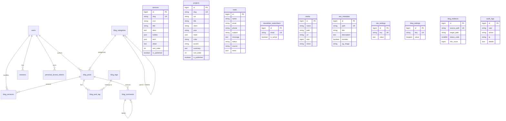
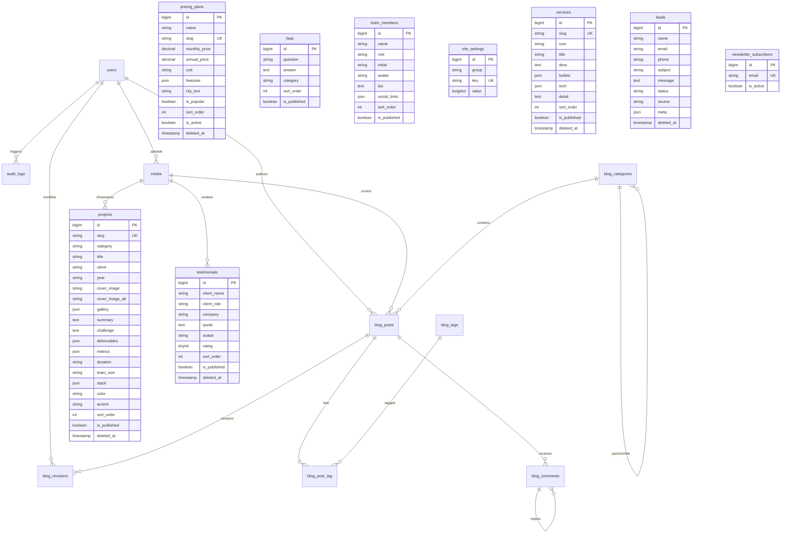

# تقرير التدقيق المعماري لطبقة قاعدة البيانات (DB_AUDIT.md)
**المشروع:** منصة Amtdex المتكاملة (`amtdex.com`)  
**الدور:** كبير مهندسي قواعد البيانات ومصممي النظم (Senior Database Architect)  
**التاريخ:** 30 أكتوبر 2026  
**نوع الفحص:** فحص وقراءة فقط (Strict Read-Only Audit) — بدون أي تعديل أو تشغيل migrations  
**حالة البيانات الحساسة:** تم حجب وتشفير كافة المفاتيح وكلمات المرور (`***`)  

---

## 1. الملخص التنفيذي (Executive Summary)

* **التقييم العام لطبقة قاعدة البيانات:** **6.2 / 10**
* **عدد الجداول المعرفة في الـ Migrations:** 20 جدولاً.
* **عدد نماذج Eloquent المعرفة في الكود:** 19 نموذجاً (منها 3 نماذج يتيمة لا توجد لها جداول في القاعدة).
* **عدد المشاكل الهيكلية المرصودة بالأدلة:** **18 مشكلة جوهرية** في بنية البيانات وسلامتها.
* **عدد الكيانات المعروضة في الواجهة بدون تمثيل في القاعدة (Hardcoded Entities):** **10 كيانات رئيسية** (الأسعار، آراء العملاء، شركاء النجاح، أعضاء الفريق، الأسئلة الشائعة، قصة النجاح، تفاصيل المشاريع العميقة، معرض اللقطات، إحصائيات الشركة، وضمانات الخدمة).

### 🚨 أهم 10 مشاكل معمارية في طبقة البيانات:

1. **انعدام أعمدة الصور في جدول المشاريع (`projects`):** جدول `projects` لا يحتوي على أي عمود للصورة أو الغلاف أو المعرض، في حين أن صفحة معرض الأعمال وصفحة تفاصيل المشروع تتطلب صوراً وغلافاً، وتعتمد حالياً على تدرج لوني CSS فقط ([2026_10_29_162213_create_projects_table.php#L14-L28](file:///c:/Users/pc/Documents/amtdex/database/migrations/2026_10_29_162213_create_projects_table.php#L14-L28)).
2. **انفصال مستودع الوسائط (`media`) التام عن الكيانات:** جدول `media` لا يرتبط بأي علاقة مع المقالات أو الخدمات أو المشاريع أو المستخدمين. كل الجداول تخزن روابط نصية مطلقة (`string URL`)، مما يؤدي لتراكم الملفات اليتيمة وتضخم مساحة التخزين لعدم وجود حذف تلقائي للملفات القديمة ([MediaController.php#L58-L68](file:///c:/Users/pc/Documents/amtdex/app/Http/Controllers/Api/V1/MediaController.php#L58-L68)).
3. **غياب جداول لبيانات تجارية حيوية معروضة للزوار:** باقات الأسعار (`PRICING`)، آراء العملاء (`TESTIMONIALS`)، شعارات الشركاء (`LOGOS`)، أعضاء الفريق (`TEAM`)، والأسئلة الشائعة (`FAQS`) مكتوبة كلياً في ملفات كود ثابتة (`pricing.ts`, `site.ts`, `AboutPage.tsx`) ولا يمكن لإدارة الموقع تعديلها من لوحة التحكم.
4. **تفاوت هائل ونواقص حرجة في لوحة التحكم (`Content/index.tsx`):** نافذة إضافة/تعديل المشاريع في لوحة التحكم تطلب فقط (Slug, Title, Client) وتغفل الحقول الإلزامية مثل `cat` و `summary` مما يسبب فشل الإضافة بخطأ 422، كما تغفل حقول التقنيات والألوان والتفاصيل ([Content/index.tsx#L193-L233](file:///c:/Users/pc/Documents/amtdex/resources/js/pages/Dashboard/Content/index.tsx#L193-L233)).
5. **جدول النشرة البريدية يتيم في لوحة التحكم (`newsletter_subscribers`):** المشتركون الجدد يُحفظون في جدول `newsletter_subscribers`، ولكن لا توجد أي شاشة أو مسار أو واجهة في لوحة التحكم لعرضهم أو تصديرهم، بينما فلتر النشرة في صفحة الطلبات يستعلم جدول `leads` الذي لا يحتوي على المشتركين ([Leads/index.tsx#L75](file:///c:/Users/pc/Documents/amtdex/resources/js/pages/Dashboard/Leads/index.tsx#L75)).
6. **نماذج يتيمة وأعمدة وهمية لفرق العمل (`Teams`):** الموديل [User.php#L40](file:///c:/Users/pc/Documents/amtdex/app/Models/User.php#L40) يحدد `current_team_id` في `$fillable`، والموديلات `Team.php`, `Membership.php`, `TeamInvitation.php` موجودة في الكود، بينما جداول `teams`, `memberships` غير موجودة إطلاقاً في أي migration!
7. **ازدواجية جداول الإعدادات (`site_settings` مقابل `blog_settings`):** وجود جدولين منفصلين لتخزين أزواج المفاتيح والقيم (Key-Value) دون مبرر معماري، مما يشتت ضبط النظام ويعقد النسخ الاحتياطي.
8. **غياب الحذف المرن (`SoftDeletes`) في كامل النظام:** لا يوجد حقل `deleted_at` في أي جدول (حتى المقالات والتعليقات والخدمات والمشاريع والطلبات)، وأي عملية حذف من لوحة التحكم هي حذف نهائي وفيزيائي لا يمكن استرجاعه.
9. **غياب فهارس الأداء والفهرس النصي الكامل (FullText Search):** استعلام البحث في المدونة يفحص حقول `title`, `summary`, `content` (وهو `longText`) عبر `LIKE '%...%'` دون وجود `FULLTEXT INDEX`، بالإضافة لغياب الفهارس المركبة على `(is_published, sort_order)`.
10. **تضارب قيود التحقق مع بنية الحقول:** حقلا `phone` و `details` يقبلان `null` في جداول القاعدة، لكن الـ Form Requests في الباك إند تفرضهما كـ `required`، مما يرفض طلبات العملاء الصالحة القادمة من الواجهات السريعة.

---

## 2. مخطط العلاقات الحالي (Current Entity-Relationship Diagram)

المخطط التالي يوضح الوضع الفعلي للبنية الحالية كما هي معرفة في الـ migrations و Eloquent Models:



> [!NOTE]
> يظهر من المخطط بوضوح وجود **كتلتين منفصلتين**: كتلة المدونة (`blog_*`) ذات علاقات محكمة ومترابطة، وكتلة باقي النظام حيث تقف جداول `services`, `projects`, `leads`, `media`, `seo_metadata`, `site_settings` كجزر معزولة تماماً بدون أي مفاتيح أجنبية (`Foreign Keys`)، مما يعكس غياب التصميم الموحد.

---

## 3. جرد كامل للجداول (Complete Tables Inventory)

### 1. جدول المستخدمين (`users`)
* **الموديل المرتبط:** [User.php](file:///c:/Users/pc/Documents/amtdex/app/Models/User.php)
* **ملف الـ Migration:** [0001_01_01_000000_create_users_table.php](file:///c:/Users/pc/Documents/amtdex/database/migrations/0001_01_01_000000_create_users_table.php) وتعديلاته في [2026_10_29_162035_add_role_to_users_table.php](file:///c:/Users/pc/Documents/amtdex/database/migrations/2026_10_29_162035_add_role_to_users_table.php) و [2026_10_29_233000_create_blog_system_tables.php](file:///c:/Users/pc/Documents/amtdex/database/migrations/2026_10_29_233000_create_blog_system_tables.php).
* **الاستخدام الفعلي:** نعم (مصادقة الدخول، كتابة مقالات المدونة، سجل العمليات).

| العمود | النوع | Nullable | Default | الفهارس | المفاتيح الأجنبية | ملاحظات |
| :--- | :--- | :--- | :--- | :--- | :--- | :--- |
| `id` | `bigint unsigned` | لا | AUTO_INCREMENT | PRIMARY KEY | لا يوجد | معرّف المستخدم |
| `name` | `varchar(255)` | لا | — | — | — | الاسم الكامل |
| `email` | `varchar(255)` | لا | — | UNIQUE | — | البريد الإلكتروني لتسجيل الدخول |
| `email_verified_at` | `timestamp` | نعم | NULL | — | — | تاريخ تأكيد البريد |
| `password` | `varchar(255)` | لا | — | — | — | كلمة المرور المشفرة بـ Bcrypt/Argon2 |
| `role` | `varchar(20)` | لا | `'viewer'` | — | — | الدور: admin, editor, author, viewer |
| `bio` | `text` | نعم | NULL | — | — | نبذة الكاتب للمدونة |
| `avatar` | `varchar(255)` | نعم | NULL | — | — | رابط صورة المستخدم |
| `social_links` | `json` | نعم | NULL | — | — | روابط التواصل الاجتماعي بصيغة JSON |
| `remember_token` | `varchar(100)` | نعم | NULL | — | — | رمز تذكر تسجيل الدخول |
| `created_at` | `timestamp` | نعم | NULL | — | — | تاريخ الإنشاء |
| `updated_at` | `timestamp` | نعم | NULL | — | — | تاريخ التعديل |

---

### 2. جدول الخدمات (`services`)
* **الموديل المرتبط:** [Service.php](file:///c:/Users/pc/Documents/amtdex/app/Models/Service.php)
* **ملف الـ Migration:** [2026_10_29_162212_create_services_table.php](file:///c:/Users/pc/Documents/amtdex/database/migrations/2026_10_29_162212_create_services_table.php)
* **الاستخدام الفعلي:** نعم (في API ولوحة التحكم، ولكن الواجهة العامة مفصولة عنه وتقرأ من مصفوفة ثابتة).

| العمود | النوع | Nullable | Default | الفهارس | المفاتيح الأجنبية | ملاحظات |
| :--- | :--- | :--- | :--- | :--- | :--- | :--- |
| `id` | `bigint unsigned` | لا | AUTO_INCREMENT | PRIMARY KEY | لا يوجد | المعرّف الأساسي |
| `slug` | `varchar(255)` | لا | — | UNIQUE | — | الرابط اللطيف الفريد |
| `icon` | `varchar(50)` | لا | `'web'` | — | — | اسم الأيقونة الرسومية |
| `title` | `varchar(255)` | لا | — | — | — | عنوان الخدمة بالعربية |
| `desc` | `text` | لا | — | — | — | الوصف المختصر |
| `bullets` | `json` | نعم | NULL | — | — | النقاط البارزة للخدمة |
| `tech` | `json` | نعم | NULL | — | — | قائمة التقنيات المستخدمة |
| `detail` | `text` | نعم | NULL | — | — | الشرح المفصل لصفحة الخدمة |
| `sort_order` | `int` | لا | `0` | — | — | ترتيب العرض (ينقصه Index) |
| `is_published` | `tinyint(1)` | لا | `1` | — | — | حالة النشر (ينقصه Index) |
| `created_at` | `timestamp` | نعم | NULL | — | — | تاريخ الإنشاء |
| `updated_at` | `timestamp` | نعم | NULL | — | — | تاريخ التحديث |

---

### 3. جدول المشاريع والأعمال (`projects`)
* **الموديل المرتبط:** [Project.php](file:///c:/Users/pc/Documents/amtdex/app/Models/Project.php)
* **ملف الـ Migration:** [2026_10_29_162213_create_projects_table.php](file:///c:/Users/pc/Documents/amtdex/database/migrations/2026_10_29_162213_create_projects_table.php)
* **الاستخدام الفعلي:** نعم (في لوحة التحكم والـ API، بينما الواجهة العامة تستخدم مصفوفة كود ثابتة).

| العمود | النوع | Nullable | Default | الفهارس | المفاتيح الأجنبية | ملاحظات |
| :--- | :--- | :--- | :--- | :--- | :--- | :--- |
| `id` | `bigint unsigned` | لا | AUTO_INCREMENT | PRIMARY KEY | لا يوجد | المعرف الأساسي |
| `slug` | `varchar(255)` | لا | — | UNIQUE | — | رابط المشروع اللطيف |
| `cat` | `varchar(255)` | لا | — | — | — | التصنيف (نص حر، تسمية غير متسقة) |
| `title` | `varchar(255)` | لا | — | — | — | عنوان المشروع |
| `client` | `varchar(255)` | لا | — | — | — | اسم العميل أو الجهة |
| `year` | `varchar(10)` | لا | `'2026'` | — | — | سنة التنفيذ |
| `stack` | `json` | نعم | NULL | — | — | حزمة التقنيات |
| `color` | `varchar(50)` | لا | `'#00e5ff'` | — | — | لون الخلفية الرئيسي للبطاقة |
| `accent` | `varchar(50)` | لا | `'emerald'` | — | — | اللون الثانوي والتأثيرات |
| `summary` | `text` | لا | — | — | — | ملخص دراسة الحالة |
| `sort_order` | `int` | لا | `0` | — | — | ترتيب الظهور |
| `is_published` | `tinyint(1)` | لا | `1` | — | — | حالة النشر |
| `created_at` | `timestamp` | نعم | NULL | — | — | تاريخ الإنشاء |
| `updated_at` | `timestamp` | نعم | NULL | — | — | تاريخ التعديل |

---

### 4. جدول طلبات التواصل والأسعار (`leads`)
* **الموديل المرتبط:** [Lead.php](file:///c:/Users/pc/Documents/amtdex/app/Models/Lead.php)
* **ملف الـ Migration:** [2026_10_29_162210_create_leads_table.php](file:///c:/Users/pc/Documents/amtdex/database/migrations/2026_10_29_162210_create_leads_table.php)
* **الاستخدام الفعلي:** نعم (استقبال نماذج /contact و /quote، وإدارتها في لوحة التحكم).

| العمود | النوع | Nullable | Default | الفهارس | المفاتيح الأجنبية | ملاحظات |
| :--- | :--- | :--- | :--- | :--- | :--- | :--- |
| `id` | `bigint unsigned` | لا | AUTO_INCREMENT | PRIMARY KEY | لا يوجد | المعرف الأساسي |
| `name` | `varchar(255)` | لا | — | — | — | اسم العميل |
| `email` | `varchar(255)` | لا | — | — | — | البريد الإلكتروني |
| `phone` | `varchar(30)` | نعم | NULL | — | — | رقم الهاتف الدولي |
| `subject` | `varchar(150)` | نعم | NULL | — | — | الموضوع أو الخدمة المطلوبة |
| `message` | `text` | لا | — | — | — | نص الرسالة أو تفاصيل الطلب |
| `status` | `varchar(50)` | لا | `'جديد'` | INDEX (مركب) | — | الحالة: جديد، قيد المراجعة، تم التواصل، مغلق |
| `source` | `varchar(50)` | لا | `'contact'` | INDEX (مركب) | — | المصدر: contact أو quote |
| `meta` | `json` | نعم | NULL | — | — | بيانات إضافية (الميزانية، الوقت، إلخ) |
| `created_at` | `timestamp` | نعم | NULL | INDEX | — | تاريخ الاستلام |
| `updated_at` | `timestamp` | نعم | NULL | — | — | تاريخ آخر تحديث للحالة |

---

### 5. جدول مشتركي النشرة البريدية (`newsletter_subscribers`)
* **الموديل المرتبط:** [NewsletterSubscriber.php](file:///c:/Users/pc/Documents/amtdex/app/Models/NewsletterSubscriber.php)
* **ملف الـ Migration:** [2026_10_29_162211_create_newsletter_subscribers_table.php](file:///c:/Users/pc/Documents/amtdex/database/migrations/2026_10_29_162211_create_newsletter_subscribers_table.php)
* **الاستخدام الفعلي:** نعم في واجهة الموقع (حفظ البريد)، لكنه **يتيم 100% في لوحة التحكم**.

| العمود | النوع | Nullable | Default | الفهارس | المفاتيح الأجنبية | ملاحظات |
| :--- | :--- | :--- | :--- | :--- | :--- | :--- |
| `id` | `bigint unsigned` | لا | AUTO_INCREMENT | PRIMARY KEY | لا يوجد | المعرف |
| `email` | `varchar(255)` | لا | — | UNIQUE | — | البريد الإلكتروني المشترك |
| `is_active` | `tinyint(1)` | لا | `1` | — | — | حالة الاشتراك (نشط/ملغى) |
| `created_at` | `timestamp` | نعم | NULL | — | — | تاريخ الاشتراك |
| `updated_at` | `timestamp` | نعم | NULL | — | — | تاريخ التعديل |

---

### 6. جدول مستودع الوسائط (`media`)
* **الموديل المرتبط:** [Media.php](file:///c:/Users/pc/Documents/amtdex/app/Models/Media.php)
* **ملف الـ Migration:** [2026_10_29_162216_create_media_table.php](file:///c:/Users/pc/Documents/amtdex/database/migrations/2026_10_29_162216_create_media_table.php)
* **الاستخدام الفعلي:** نعم في شاشة الوسائط فقط، لكنه **معزول تماماً** عن باقي الجداول.

| العمود | النوع | Nullable | Default | الفهارس | المفاتيح الأجنبية | ملاحظات |
| :--- | :--- | :--- | :--- | :--- | :--- | :--- |
| `id` | `bigint unsigned` | لا | AUTO_INCREMENT | PRIMARY KEY | لا يوجد | معرّف الملف |
| `name` | `varchar(255)` | لا | — | — | — | الاسم الأصلي للملف المرفوع |
| `path` | `varchar(255)` | لا | — | — | — | المسار الداخلي على القرص (public disk) |
| `url` | `varchar(255)` | لا | — | — | — | الرابط العام المباشر (`/storage/...`) |
| `size` | `bigint unsigned` | لا | — | — | — | حجم الملف بالبايت |
| `mime` | `varchar(255)` | لا | — | — | — | نوع ملف الميديا MIME Type |
| `created_at` | `timestamp` | نعم | NULL | — | — | تاريخ الرفع |
| `updated_at` | `timestamp` | نعم | NULL | — | — | تاريخ التعديل |

---

### 7. جدول البيانات الوصفية للسيو (`seo_metadata`)
* **الموديل المرتبط:** [SeoMetadata.php](file:///c:/Users/pc/Documents/amtdex/app/Models/SeoMetadata.php)
* **ملف الـ Migration:** [2026_10_29_162214_create_seo_metadata_table.php](file:///c:/Users/pc/Documents/amtdex/database/migrations/2026_10_29_162214_create_seo_metadata_table.php)
* **الاستخدام الفعلي:** نعم في لوحة تحكم SEO ومكون الرأس.

| العمود | النوع | Nullable | Default | الفهارس | المفاتيح الأجنبية | ملاحظات |
| :--- | :--- | :--- | :--- | :--- | :--- | :--- |
| `id` | `bigint unsigned` | لا | AUTO_INCREMENT | PRIMARY KEY | لا يوجد | المعرف |
| `path` | `varchar(255)` | لا | — | UNIQUE | — | مسار الصفحة (مثل `/`, `/services`) |
| `title` | `varchar(255)` | لا | — | — | — | عنوان الصفحة في محركات البحث |
| `description` | `text` | لا | — | — | — | وصف الصفحة الميتا |
| `noindex` | `tinyint(1)` | لا | `0` | — | — | منع أرشفة محركات البحث |
| `og_image` | `varchar(255)` | نعم | NULL | — | — | صورة المشاركة الاجتماعية (مهمل باللوحة) |
| `created_at` | `timestamp` | نعم | NULL | — | — | تاريخ الإنشاء |
| `updated_at` | `timestamp` | نعم | NULL | — | — | تاريخ التحديث |

---

### 8. جدول إعدادات الموقع العامة (`site_settings`)
* **الموديل المرتبط:** [SiteSetting.php](file:///c:/Users/pc/Documents/amtdex/app/Models/SiteSetting.php)
* **ملف الـ Migration:** [2026_10_29_162215_create_site_settings_table.php](file:///c:/Users/pc/Documents/amtdex/database/migrations/2026_10_29_162215_create_site_settings_table.php)
* **الاستخدام الفعلي:** نعم (يخزن 3 مفاتيح فقط: `siteName`, `email`, `phone`).

| العمود | النوع | Nullable | Default | الفهارس | المفاتيح الأجنبية | ملاحظات |
| :--- | :--- | :--- | :--- | :--- | :--- | :--- |
| `id` | `bigint unsigned` | لا | AUTO_INCREMENT | PRIMARY KEY | لا يوجد | المعرف |
| `key` | `varchar(255)` | لا | — | UNIQUE | — | اسم الإعداد (Key) |
| `value` | `text` | نعم | NULL | — | — | قيمة الإعداد النصية |
| `created_at` | `timestamp` | نعم | NULL | — | — | تاريخ الإنشاء |
| `updated_at` | `timestamp` | نعم | NULL | — | — | تاريخ التعديل |

---

### 9. جدول سجل تدقيق العمليات (`audit_logs`)
* **الموديل المرتبط:** [AuditLog.php](file:///c:/Users/pc/Documents/amtdex/app/Models/AuditLog.php)
* **ملف الـ Migration:** [2026_10_29_162217_create_audit_logs_table.php](file:///c:/Users/pc/Documents/amtdex/database/migrations/2026_10_29_162217_create_audit_logs_table.php)
* **الاستخدام الفعلي:** نعم (يسجل عمليات الإضافة والحذف والتعديل).

| العمود | النوع | Nullable | Default | الفهارس | المفاتيح الأجنبية | ملاحظات |
| :--- | :--- | :--- | :--- | :--- | :--- | :--- |
| `id` | `bigint unsigned` | لا | AUTO_INCREMENT | PRIMARY KEY | لا يوجد | معرّف السجل |
| `user` | `varchar(255)` | لا | — | — | — | بريد المستخدم المنفذ (نص حر دون FK) |
| `action` | `varchar(255)` | لا | — | — | — | الإجراء المنفذ بالعربية |
| `ip` | `varchar(45)` | لا | — | — | — | عنوان الآي بي للمنفذ |
| `details` | `json` | نعم | NULL | — | — | تفاصيل إضافية للعملية |
| `created_at` | `timestamp` | نعم | NULL | INDEX | — | توقيت حدوث الإجراء |
| `updated_at` | `timestamp` | نعم | NULL | — | — | توقيت التحديث |

---

### 10. جدول تصنيفات المدونة (`blog_categories`)
* **الموديل المرتبط:** [BlogCategory.php](file:///c:/Users/pc/Documents/amtdex/app/Models/BlogCategory.php)
* **ملف الـ Migration:** [2026_10_29_233000_create_blog_system_tables.php#L28-L45](file:///c:/Users/pc/Documents/amtdex/database/migrations/2026_10_29_233000_create_blog_system_tables.php#L28-L45)
* **الاستخدام الفعلي:** نعم في المدونة ولوحة التحكم وتغذية RSS.

| العمود | النوع | Nullable | Default | الفهارس | المفاتيح الأجنبية | ملاحظات |
| :--- | :--- | :--- | :--- | :--- | :--- | :--- |
| `id` | `bigint unsigned` | لا | AUTO_INCREMENT | PRIMARY KEY | لا يوجد | معرّف التصنيف |
| `parent_id` | `bigint unsigned` | نعم | NULL | INDEX | `blog_categories.id` (ON DELETE SET NULL) | للتصنيفات الشجرية الفرعية |
| `name` | `varchar(255)` | لا | — | — | — | اسم التصنيف |
| `slug` | `varchar(255)` | لا | — | UNIQUE | — | رابط التصنيف اللطيف |
| `description` | `text` | نعم | NULL | — | — | وصف التصنيف |
| `image` | `varchar(255)` | نعم | NULL | — | — | صورة الغلاف للتصنيف |
| `sort_order` | `int` | لا | `0` | — | — | ترتيب الظهور |
| `is_visible` | `tinyint(1)` | لا | `1` | — | — | إظهار/إخفاء التصنيف |
| `meta_title` | `varchar(255)` | نعم | NULL | — | — | عنوان السيو للتصنيف |
| `meta_description`| `text` | نعم | NULL | — | — | وصف السيو للتصنيف |
| `canonical_url` | `varchar(255)` | نعم | NULL | — | — | الرابط الأصلي الكانونيكال |
| `noindex` | `tinyint(1)` | لا | `0` | — | — | خيار منع الأرشفة |
| `created_at` | `timestamp` | نعم | NULL | — | — | تاريخ الإنشاء |
| `updated_at` | `timestamp` | نعم | NULL | — | — | تاريخ التحديث |

---

### 11. جدول وسوم المدونة (`blog_tags`)
* **الموديل المرتبط:** [BlogTag.php](file:///c:/Users/pc/Documents/amtdex/app/Models/BlogTag.php)
* **ملف الـ Migration:** [2026_10_29_233000_create_blog_system_tables.php#L48-L60](file:///c:/Users/pc/Documents/amtdex/database/migrations/2026_10_29_233000_create_blog_system_tables.php#L48-L60)
* **الاستخدام الفعلي:** نعم في ربط وتصفية المقالات.

| العمود | النوع | Nullable | Default | الفهارس | المفاتيح الأجنبية | ملاحظات |
| :--- | :--- | :--- | :--- | :--- | :--- | :--- |
| `id` | `bigint unsigned` | لا | AUTO_INCREMENT | PRIMARY KEY | لا يوجد | معرّف الوسم |
| `name` | `varchar(255)` | لا | — | — | — | اسم الوسم |
| `slug` | `varchar(255)` | لا | — | UNIQUE | — | رابط الوسم الفريد |
| `description` | `text` | نعم | NULL | — | — | وصف الوسم |
| `meta_title` | `varchar(255)` | نعم | NULL | — | — | عنوان السيو |
| `meta_description`| `text` | نعم | NULL | — | — | وصف السيو |
| `noindex` | `tinyint(1)` | لا | `0` | — | — | منع أرشفة الوسم |
| `created_at` | `timestamp` | نعم | NULL | — | — | تاريخ الإنشاء |
| `updated_at` | `timestamp` | نعم | NULL | — | — | تاريخ التعديل |

---

### 12. جدول مقالات المدونة (`blog_posts`)
* **الموديل المرتبط:** [BlogPost.php](file:///c:/Users/pc/Documents/amtdex/app/Models/BlogPost.php)
* **ملف الـ Migration:** [2026_10_29_233000_create_blog_system_tables.php#L63-L107](file:///c:/Users/pc/Documents/amtdex/database/migrations/2026_10_29_233000_create_blog_system_tables.php#L63-L107)
* **الاستخدام الفعلي:** نعم (العنصر الأضخم في النظام: المقالات، تفاصيلها، محرر الإدارة).

| العمود | النوع | Nullable | Default | الفهارس | المفاتيح الأجنبية | ملاحظات |
| :--- | :--- | :--- | :--- | :--- | :--- | :--- |
| `id` | `bigint unsigned` | لا | AUTO_INCREMENT | PRIMARY KEY | لا يوجد | معرّف المقال |
| `author_id` | `bigint unsigned` | لا | — | INDEX | `users.id` (ON DELETE CASCADE) | كاتب المقال |
| `category_id` | `bigint unsigned` | نعم | NULL | INDEX | `blog_categories.id` (SET NULL) | تصنيف المقال الرئيسي |
| `title` | `varchar(255)` | لا | — | — | — | عنوان المقال الرئيسي |
| `slug` | `varchar(255)` | لا | — | UNIQUE | — | رابط المقال الدائم |
| `summary` | `text` | نعم | NULL | — | — | ملخص المقال ومقتطف العرض |
| `content` | `longtext` | لا | — | — | — | المحتوى الكامل بصيغة HTML |
| `cover_image` | `varchar(255)` | نعم | NULL | — | — | صورة الغلاف الرئيسية |
| `cover_image_alt` | `varchar(255)` | نعم | NULL | — | — | النص البديل لصورة الغلاف |
| `status` | `varchar(255)` | لا | `'draft'` | INDEX | — | draft, published, scheduled, archived |
| `published_at` | `timestamp` | نعم | NULL | INDEX | — | تاريخ وتوقيت النشر الفعلي |
| `reading_time_minutes`| `smallint unsigned`| لا | `3` | — | — | وقت القراءة المحسوب بالدقائق |
| `views_count` | `bigint unsigned` | لا | `0` | — | — | عدد القراءات والمشاهدات |
| `is_featured` | `tinyint(1)` | لا | `0` | INDEX | — | مقال مميز في الصفحة الأولى |
| `allow_comments` | `tinyint(1)` | لا | `1` | — | — | السماح بالتعليقات على المقال |
| `focus_keyword` | `varchar(255)` | نعم | NULL | — | — | الكلمة المفتاحية المستهدفة |
| `meta_title` | `varchar(255)` | نعم | NULL | — | — | عنوان السيو للمقال |
| `meta_description`| `text` | نعم | NULL | — | — | وصف السيو للمقال |
| `canonical_url` | `varchar(255)` | نعم | NULL | — | — | الرابط الأصلي لتفادي المحتوى المكرر |
| `robots_index` | `tinyint(1)` | لا | `1` | — | — | السماح بمحركات البحث بالأرشفة |
| `robots_follow` | `tinyint(1)` | لا | `1` | — | — | السماح بمتابعة الروابط الداخلية |
| `og_title` | `varchar(255)` | نعم | NULL | — | — | عنوان بطاقة Open Graph |
| `og_description` | `text` | نعم | NULL | — | — | وصف بطاقة Open Graph |
| `og_image` | `varchar(255)` | نعم | NULL | — | — | صورة المشاركة على شبكات التواصل |
| `og_type` | `varchar(255)` | لا | `'article'` | — | — | نوع بطاقة السوشيال ميديا |
| `twitter_card` | `varchar(255)` | لا | `'summary_large_image'` | — | — | نوع بطاقة تويتر |
| `twitter_title` | `varchar(255)` | نعم | NULL | — | — | عنوان بطاقة تويتر |
| `twitter_description`| `text` | نعم | NULL | — | — | وصف بطاقة تويتر |
| `twitter_image` | `varchar(255)` | نعم | NULL | — | — | صورة بطاقة تويتر |
| `schema_type` | `varchar(255)` | لا | `'BlogPosting'` | — | — | نوع هيكل البيانات Schema.org |
| `faq_schema` | `json` | نعم | NULL | — | — | أسئلة وأجوبة منظمة للمقال |
| `created_at` | `timestamp` | نعم | NULL | — | — | تاريخ الإنشاء |
| `updated_at` | `timestamp` | نعم | NULL | — | — | تاريخ آخر تعديل |

---

### 13. جدول وسوم المقالات الوسيط (`blog_post_tag`)
* **النوع:** Pivot Table (علاقة Many-to-Many بين `blog_posts` و `blog_tags`).
* **ملف الـ Migration:** [2026_10_29_233000_create_blog_system_tables.php#L110-L115](file:///c:/Users/pc\Documents\amtdex\database\migrations\2026_10_29_233000_create_blog_system_tables.php#L110-L115)

| العمود | النوع | Nullable | Default | الفهارس | المفاتيح الأجنبية |
| :--- | :--- | :--- | :--- | :--- | :--- |
| `post_id` | `bigint unsigned` | لا | — | PRIMARY KEY (مركب) | `blog_posts.id` (ON DELETE CASCADE) |
| `tag_id` | `bigint unsigned` | لا | — | PRIMARY KEY (مركب) | `blog_tags.id` (ON DELETE CASCADE) |

---

### 14. جدول تعليقات المدونة (`blog_comments`)
* **الموديل المرتبط:** [BlogComment.php](file:///c:/Users/pc/Documents/amtdex/app/Models/BlogComment.php)
* **ملف الـ Migration:** [2026_10_29_233000_create_blog_system_tables.php#L117-L130](file:///c:/Users/pc/Documents/amtdex/database/migrations/2026_10_29_233000_create_blog_system_tables.php#L117-L130)

| العمود | النوع | Nullable | Default | الفهارس | المفاتيح الأجنبية | ملاحظات |
| :--- | :--- | :--- | :--- | :--- | :--- | :--- |
| `id` | `bigint unsigned` | لا | AUTO_INCREMENT | PRIMARY KEY | لا يوجد | معرّف التعليق |
| `post_id` | `bigint unsigned` | لا | — | INDEX | `blog_posts.id` (CASCADE) | المقال المعلق عليه |
| `parent_id` | `bigint unsigned` | نعم | NULL | INDEX | `blog_comments.id` (CASCADE) | للردود المتداخلة (Replies) |
| `author_name` | `varchar(255)` | لا | — | — | — | اسم صاحب التعليق |
| `author_email`| `varchar(255)` | لا | — | — | — | بريد صاحب التعليق |
| `author_url` | `varchar(255)` | نعم | NULL | — | — | موقع صاحب التعليق (إن وجد) |
| `content` | `text` | لا | — | — | — | نص التعليق |
| `status` | `varchar(255)` | لا | `'pending'` | INDEX | — | pending, approved, rejected, spam |
| `ip_address` | `varchar(45)` | نعم | NULL | — | — | آي بي كاتب التعليق لمكافحة السبام |
| `user_agent` | `text` | نعم | NULL | — | — | متصفح ونظام كاتب التعليق |
| `created_at` | `timestamp` | نعم | NULL | — | — | تاريخ الإرسال |
| `updated_at` | `timestamp` | نعم | NULL | — | — | تاريخ التعديل |

---

### 15. جدول التحويلات الدائمة (`blog_redirects`)
* **الموديل المرتبط:** [BlogRedirect.php](file:///c:/Users/pc/Documents/amtdex/app/Models/BlogRedirect.php)
* **ملف الـ Migration:** [2026_10_29_233000_create_blog_system_tables.php#L132-L139](file:///c:/Users/pc/Documents/amtdex/database/migrations/2026_10_29_233000_create_blog_system_tables.php#L132-L139)

| العمود | النوع | Nullable | Default | الفهارس | المفاتيح الأجنبية | ملاحظات |
| :--- | :--- | :--- | :--- | :--- | :--- | :--- |
| `id` | `bigint unsigned` | لا | AUTO_INCREMENT | PRIMARY KEY | لا يوجد | المعرف |
| `source_path` | `varchar(255)` | لا | — | UNIQUE | — | المسار القديم المحول منه |
| `target_path` | `varchar(255)` | لا | — | — | — | المسار الجديد المحول إليه |
| `status_code` | `smallint unsigned` | لا | `301` | — | — | كود التحويل (301 أو 302) |
| `hits_count` | `bigint unsigned` | لا | `0` | — | — | عدد مرات تنفيذ التحويل |
| `created_at` | `timestamp` | نعم | NULL | — | — | تاريخ الإنشاء |
| `updated_at` | `timestamp` | نعم | NULL | — | — | تاريخ التحديث |

---

### 16. جدول مراجعات وتاريخ المقالات (`blog_revisions`)
* **الموديل المرتبط:** [BlogRevision.php](file:///c:/Users/pc/Documents/amtdex/app/Models/BlogRevision.php)
* **ملف الـ Migration:** [2026_10_29_233000_create_blog_system_tables.php#L142-L150](file:///c:/Users/pc/Documents/amtdex/database/migrations/2026_10_29_233000_create_blog_system_tables.php#L142-L150)

| العمود | النوع | Nullable | Default | الفهارس | المفاتيح الأجنبية | ملاحظات |
| :--- | :--- | :--- | :--- | :--- | :--- | :--- |
| `id` | `bigint unsigned` | لا | AUTO_INCREMENT | PRIMARY KEY | لا يوجد | معرّف النسخة |
| `post_id` | `bigint unsigned` | لا | — | INDEX | `blog_posts.id` (CASCADE) | المقال الأصلي |
| `user_id` | `bigint unsigned` | نعم | NULL | INDEX | `users.id` (SET NULL) | المستخدم الذي أجرى التعديل |
| `title` | `varchar(255)` | لا | — | — | — | عنوان المقال في تلك النسخة |
| `summary` | `text` | نعم | NULL | — | — | ملخص المقال في النسخة |
| `content` | `longtext` | لا | — | — | — | محتوى المقال الكامل في النسخة |
| `created_at` | `timestamp` | لا | CURRENT_TIMESTAMP | — | — | تاريخ حفظ النسخة التلقائي |

---

### 17. جدول إعدادات المدونة (`blog_settings`)
* **الموديل المرتبط:** [BlogSetting.php](file:///c:/Users/pc/Documents/amtdex/app/Models/BlogSetting.php)
* **ملف الـ Migration:** [2026_10_29_233000_create_blog_system_tables.php#L153-L158](file:///c:/Users/pc/Documents/amtdex/database/migrations/2026_10_29_233000_create_blog_system_tables.php#L153-L158)

| العمود | النوع | Nullable | Default | الفهارس | المفاتيح الأجنبية | ملاحظات |
| :--- | :--- | :--- | :--- | :--- | :--- | :--- |
| `id` | `bigint unsigned` | لا | AUTO_INCREMENT | PRIMARY KEY | لا يوجد | المعرف |
| `key` | `varchar(255)` | لا | — | UNIQUE | — | اسم الإعداد (Key) |
| `value` | `longtext` | نعم | NULL | — | — | القيمة (نص عادي أو JSON مشفر) |
| `created_at` | `timestamp` | نعم | NULL | — | — | تاريخ الإنشاء |
| `updated_at` | `timestamp` | نعم | NULL | — | — | تاريخ التعديل |

---

### 18-20. جداول إطار العمل المدمجة (`password_reset_tokens`, `sessions`, `personal_access_tokens`)
* **`password_reset_tokens`:** معرّفة في [0001_01_01_000000_create_users_table.php#L27-L33](file:///c:/Users/pc/Documents/amtdex/database/migrations/0001_01_01_000000_create_users_table.php#L27-L33). الأعمدة: `email` (PK), `token`, `created_at`.
* **`sessions`:** معرّفة في [0001_01_01_000000_create_users_table.php#L35-L44](file:///c:/Users/pc/Documents/amtdex/database/migrations/0001_01_01_000000_create_users_table.php#L35-L44). الأعمدة: `id` (PK), `user_id` (Index), `ip_address`, `user_agent`, `payload`, `last_activity` (Index).
* **`personal_access_tokens`:** معرّفة في [2026_10_29_161618_create_personal_access_tokens_table.php](file:///c:/Users/pc/Documents/amtdex/database/migrations/2026_10_29_161618_create_personal_access_tokens_table.php). الأعمدة: `id` (PK), `tokenable_type`, `tokenable_id`, `name`, `token` (UK), `abilities`, `last_used_at`, `expires_at` (Index), `created_at`, `updated_at`.

---

## 4. مصفوفة المطابقة الشاملة: الواجهة ↔ قاعدة البيانات (Parity Matrix)

هذا الفحص يقارن كل عنصر وبيانات معروضة في صفحات الموقع ولوحة التحكم مع القاعدة:

| الصفحة / القسم | العنصر المعروض | هل يُعرض للزوار؟ | هل يوجد عمود/جدول في القاعدة؟ | هل له خانة في لوحة التحكم؟ | مصدر البيانات الحالي والتشخيص الدقيق |
| :--- | :--- | :--- | :--- | :--- | :--- |
| **الرئيسية (Hero)** | شارة عدد المستخدمين النشطين (1.2k+ مستخدم) | نعم | ❌ لا يوجد | ❌ لا | نص ثابت Hardcoded في [HomePage.tsx#L90](file:///c:/Users/pc/Documents/amtdex/resources/js/pages/Home/HomePage.tsx#L90) |
| **الرئيسية (شريط الإحصائيات)** | 4 أرقام: (+120 مشروع، 24/7 خبرة، 98% رضا، 4.9 تقييم) | نعم | ❌ لا يوجد | ❌ لا | مصفوفة ثابتة Hardcoded في [StatsBand.tsx#L2-L7](file:///c:/Users/pc/Documents/amtdex/resources/js/pages/Home/StatsBand.tsx#L2-L7) |
| **الرئيسية (العملاء)** | شعارات الشركاء والعملاء (نون، أرامكو، STC...) | نعم | ❌ لا يوجد | ❌ لا | مصفوفة نصوص ثابتة في [site.ts#L7](file:///c:/Users/pc/Documents/amtdex/resources/js/data/site.ts#L7) |
| **الرئيسية (معرض اللقطات)** | 6 لقطات لواجهات برمجية ومتاجر | نعم | ❌ لا يوجد | ❌ لا | ملفات webp ثابتة داخل مجلد public في [ScreenGallery.tsx#L3-L10](file:///c:/Users/pc/Documents/amtdex/resources/js/pages/Home/ScreenGallery.tsx#L3-L10) |
| **الرئيسية (قصة النجاح)** | دراسة حالة "نخبة nukhba.sa" وإحصائياتها (+60%) | نعم | ❌ لا يوجد | ❌ لا | نصوص وأرقام ثابتة في [SpotlightSection.tsx#L8-L16](file:///c:/Users/pc/Documents/amtdex/resources/js/pages/Home/SpotlightSection.tsx#L8-L16) |
| **الرئيسية (آراء العملاء)** | آراء وتجارب العملاء (سارة، عمر، نورة) | نعم | ❌ لا يوجد | ❌ لا | مصفوفة كود ثابتة في [site.ts#L1-L5](file:///c:/Users/pc/Documents/amtdex/resources/js/data/site.ts#L1-L5) |
| **الرئيسية (الضمان)** | بانر ضمان استرجاع الدفعة الأخيرة | نعم | ❌ لا يوجد | ❌ لا | نص ثابت في [GuaranteeBanner.tsx#L7-L8](file:///c:/Users/pc/Documents/amtdex/resources/js/pages/Home/GuaranteeBanner.tsx#L7-L8) |
| **الرئيسية والفوتر** | الاشتراك في النشرة البريدية | نعم | ✅ `newsletter_subscribers` | ❌ **لا توجد أي شاشة** | البريد يُسجل في القاعدة، لكن لوحة التحكم تتجاهله تماماً! |
| **من نحن (About)** | إحصائيات التأسيس (+120، 12 عضو، 2026) | نعم | ❌ لا يوجد | ❌ لا | نصوص ثابتة في [AboutPage.tsx#L40-L49](file:///c:/Users/pc/Documents/amtdex/resources/js/pages/About/AboutPage.tsx#L40-L49) |
| **من نحن (About)** | قيم الشركة (الجودة، السرعة، الشفافية) | نعم | ❌ لا يوجد | ❌ لا | نصوص ثابتة في [AboutPage.tsx#L55-L69](file:///c:/Users/pc/Documents/amtdex/resources/js/pages/About/AboutPage.tsx#L55-L69) |
| **من نحن (About)** | أعضاء فريق العمل الأربعة (أحمد، ريم، فيصل، لينا) | نعم | ❌ لا يوجد | ❌ لا | مصفوفة ثابتة في [site.ts#L9-L14](file:///c:/Users/pc/Documents/amtdex/resources/js/data/site.ts#L9-L14) منفصلة عن جدول `users` |
| **من نحن (About)** | الأسئلة الشائعة (8 أسئلة وإجاباتها) | نعم | ❌ لا يوجد | ❌ لا | مصفوفات ثابتة في [AboutPage.tsx#L8-L23](file:///c:/Users/pc/Documents/amtdex/resources/js/pages/About/AboutPage.tsx#L8-L23) |
| **الخدمات (Services)** | عنوان الخدمة ووصفها | نعم | ✅ `services.title`, `desc` | ✅ نعم | متطابق مع القاعدة |
| **الخدمات (Services)** | أيقونة الخدمة | نعم | ✅ `services.icon` | ❌ **لا توجد خانة** | الحقل في القاعدة `varchar(50)` لكن لا يوجد مدخل له باللوحة |
| **الخدمات (Services)** | مميزات الخدمة والتقنيات (`bullets`, `tech`) | نعم | ✅ `services.bullets`, `tech` | ❌ **لا توجد خانة** | الحقول في القاعدة `json` لكن لا توجد لها خانات إدخال في المودال! |
| **الخدمات (Services)** | الشرح التفصيلي للخدمة (`detail`) | نعم | ✅ `services.detail` | ❌ **لا توجد خانة** | الحقل موجود في القاعدة كنص، ومفقود من نافذة الإدخال |
| **الخدمات (Services)** | ترتيب وظهور الخدمة (`sort_order`, `is_published`)| نعم | ✅ `services.sort_order`, `is_published` | ❌ **لا توجد خانة** | لا يمكن للأدمن إخفاء خدمة أو تغيير ترتيبها من اللوحة |
| **الأعمال (Portfolio)** | عنوان المشروع واسم العميل والسنة | نعم | ✅ `projects.title`, `client`, `year` | ⚠️ ناقصة | السنة غير موجودة في نافذة الإدخال |
| **الأعمال (Portfolio)** | تصنيف المشروع (`cat`) | نعم | ✅ `projects.cat` | ❌ **مفقود من المودال** | حقل إلزامي في القاعدة، وغيابه يمنع إضافة مشاريع جديدة! |
| **الأعمال (Portfolio)** | ملخص المشروع (`summary`) | نعم | ✅ `projects.summary` | ❌ **مفقود من المودال** | حقل إلزامي في الـ Controller، غيابه يسبب خطأ 422! |
| **الأعمال (Portfolio)** | صورة/غلاف المشروع | نعم | ❌ **لا يوجد عمود إطلاقاً** | ❌ لا | لا يوجد أي عمود للصور في جدول `projects`! |
| **تفاصيل المشروع** | "التحدي" (Challenge) الخاص بالمشروع | نعم | ❌ لا يوجد | ❌ لا | نص ثابت مكرر لكل المشاريع في [PortfolioDetailPage.tsx#L45-L48](file:///c:/Users/pc/Documents/amtdex/resources/js/pages/Portfolio/PortfolioDetailPage.tsx#L45-L48) |
| **تفاصيل المشروع** | "ما بنيناه" (Deliverables - 5 بنود) | نعم | ❌ لا يوجد | ❌ لا | مصفوفة ثابتة مكررة في [PortfolioDetailPage.tsx#L51-L57](file:///c:/Users/pc/Documents/amtdex/resources/js/pages/Portfolio/PortfolioDetailPage.tsx#L51-L57) |
| **تفاصيل المشروع** | "النتائج والمؤشرات" (+40%, 2.1x, 99.9%) | نعم | ❌ لا يوجد | ❌ لا | أرقام ثابتة وهمية مكررة في [PortfolioDetailPage.tsx#L60-L69](file:///c:/Users/pc/Documents/amtdex/resources/js/pages/Portfolio/PortfolioDetailPage.tsx#L60-L69) |
| **تفاصيل المشروع** | مدة المشروع وحجم الفريق (8 أسابيع، 5 أشخاص) | نعم | ❌ لا يوجد | ❌ لا | نصوص ثابتة مكررة في [PortfolioDetailPage.tsx#L86-L91](file:///c:/Users/pc/Documents/amtdex/resources/js/pages/Portfolio/PortfolioDetailPage.tsx#L86-L91) |
| **الأسعار (Pricing)** | الباقات الـ 3 وأسعارها ومميزاتها | نعم | ❌ لا يوجد | ❌ لا | مصفوفة كود ثابتة في [pricing.ts#L1-L5](file:///c:/Users/pc/Documents/amtdex/resources/js/data/pricing.ts#L1-L5) |
| **طلب عرض السعر** | الميزانية والمدة المختارة | نعم | ✅ `leads.meta` (JSON) | ⚠️ جزئي | تظهر كـ message، ولا تظهر كأعمدة مستقلة في جدول اللوحة |
| **المستخدمون (Users)** | صورة المستخدم الشخصية (`avatar`) | لا (باللوحة فقط) | ✅ `users.avatar` | ❌ لا توجد خانة | صفحة المستخدمين للعرض فقط ولا يمكن تعديل أو رفع صورة |
| **المستخدمون (Users)** | نبذة المستخدم وروابطه (`bio`, `social_links`) | نعم بالمدونة | ✅ `users.bio`, `social_links` | ❌ لا توجد خانة | لا توجد شاشة في لوحة التحكم لتعديل الملف الشخصي للكاتب |
| **الوسائط (Media)** | عنوان ورابط ونوع وحجم الملف | لا (باللوحة) | ✅ `media.*` | ✅ عرض فقط | لا يوجد زر حذف ولا زر نسخ الرابط في [Media/index.tsx](file:///c:/Users/pc/Documents/amtdex/resources/js/pages/Dashboard/Media/index.tsx) |
| **الوسائط (Media)** | النص البديل وأبعاد الصورة (`alt`, `dimensions`)| لا | ❌ لا يوجد عمود | ❌ لا | غير مدعوم في بنية جدول `media` |
| **السيو (SEO)** | صورة المشاركة الاجتماعية (`og_image`) | نعم بالرأس | ✅ `seo_metadata.og_image` | ❌ **مفقود من المودال** | العمود موجود في القاعدة لكن نافذة التعديل لا توفر خانة له |
| **الإعدادات (Settings)** | روابط السوشيال ميديا وعنوان المقر | نعم بالفوتر | ❌ لا يوجد | ❌ لا | [SiteSetting.php](file:///c:/Users/pc/Documents/amtdex/app/Models/SiteSetting.php) يدعم فقط اسم الموقع والبريد والهاتف |
| **لوحة التحكم (Overview)**| عدد المشاريع النشطة | باللوحة | ✅ `projects` | — | الـ Controller يعرض حداً أدنى وهمياً `max($count, 12)` |

---

## 5. تقرير الصور والملفات (Media & Storage Deep Dive)

### 1. كيف وأين تُخزن الصور والملفات؟
* **آلية التخزين:** تُخزن الملفات المرفوعة عبر [MediaController.php#L59](file:///c:/Users/pc/Documents/amtdex/app/Http/Controllers/Api/V1/MediaController.php#L59) في القرص المحلي الافتراضي: `storage/app/public/media/` عبر دالة `$file->storeAs('media', $safeName, 'public')`.
* **الرابط المحفوظ:** يتم حفظ الرابط كمسار نسبي `/storage/media/{hash}.{ext}` في حقل `media.url`.

### 2. هل توجد علاقة بين جدول الوسائط وباقي الجداول؟
* **الواقع الفعلي:** **لا توجد أي علاقة إطلاقاً (Zero Relationships)**.
  * جدول `blog_posts` يخزن الرابط في عمود نصي حر `cover_image` (نوعه `varchar(255)`).
  * جدول `blog_categories` يخزن الرابط في عمود نصي حر `image`.
  * جدول `users` يخزن الرابط في عمود نصي حر `avatar`.
  * جدول `seo_metadata` يخزن الرابط في عمود نصي حر `og_image`.
  * جدول `projects` لا يحتوي على أي عمود للصورة إطلاقاً.
* **النتيجة:** لا يوجد أي `media_id` أو علاقة `MorphToMany` أو `belongsTo(Media::class)`. الكاتب يكتب الرابط بيده أو ينسخه، دون أي ربط مرجعي.

### 3. هل تُحذف الصورة القديمة عند التعديل أو الحذف؟
* **الواقع الفعلي:** **لا تُحذف نهائياً (Orphan Files Accumulation)**.
  * عند قيام المستخدم بتحديث صورة غلاف مقال أو حذف المقال كلياً، دالة [AdminBlogController.php#L272](file:///c:/Users/pc/Documents/amtdex/app/Http/Controllers/Api/V1/Blog/AdminBlogController.php#L272) تنفذ `$post->delete()` فقط. ملف الصورة القديم يبقى موجوداً في `storage/app/public/media/` وسجله يبقى في جدول `media` للأبد دون أن يحذفه أحد.
  * هذا يؤدي إلى استهلاك مستمر وغير مبرر لمساحة الخادم (Disk Space Leak).

### 4. خصائص الصور والبيانات الوصفية المفقودة في جدول `media`:
* **النص البديل (`alt_text`):** غير موجود في جدول `media`. (موجود فقط كعمود معزول `cover_image_alt` داخل جدول `blog_posts`، وغير متوفر لباقي الصور).
* **أبعاد الصورة (`width`, `height`):** غير مسجلة في جدول `media`، مما يمنع متصفحات الويب من حجز مساحة العرض مسبقاً ويسبب ظاهرة القفز البصري (CLS - Cumulative Layout Shift).
* **القرص المرفوع عليه (`disk`):** غير مسجل، والافتراض دائماً أنه القرص المحلي (`public`).
* **معرّف رافع الملف (`user_id`):** غير موجود، ولا يمكن معرفة من قام برفع أي ملف وسائط لأغراض الأمان والمساءلة.

### 5. جرد الصور واللقطات المكتوبة Hardcoded بدون أي مصدر في القاعدة:
1. صور معرض الواجهات: `/images/screens/business.webp`, `/images/screens/shop.webp`, `/images/screens/projects.webp`, `/images/screens/wallet.webp`, `/images/screens/health.webp`, `/images/screens/crm.webp`.
2. صور البذور المستخدمة كأغلفة افتراضية للمقالات والتصنيفات في [BlogSeeder.php#L28-L90](file:///c:/Users/pc/Documents/amtdex/database/seeders/BlogSeeder.php#L28-L90).
3. صور وأيقونات الخدمات: رموز نصية `web`, `mobile`, `erp`, `ai`, `security`, `cloud` مستدعاة من مكون SVG محلي.

---

## 6. تقرير التوازن والاتساق بين الجداول (Balance & Consistency)

### 1. مقارنة الجداول المتشابهة (المحتوى: الخدمات vs المشاريع vs المقالات):

| الخاصية | جدول الخدمات (`services`) | جدول المشاريع (`projects`) | جدول المقالات (`blog_posts`) | التقييم والخلل |
| :--- | :--- | :--- | :--- | :--- |
| **المعرّف اللطيف** | `slug` (varchar unique) | `slug` (varchar unique) | `slug` (varchar unique) | متسق وممتاز |
| **العنوان** | `title` (varchar) | `title` (varchar) | `title` (varchar) | متسق وممتاز |
| **التصنيف** | لا يوجد تصنيف إطلاقاً | `cat` (نص حر varchar) | `category_id` (FK لجدول مستقل) | ❌ عدم اتساق صارخ |
| **الوصف والمحتوى** | `desc` (text) + `detail` | `summary` (text) | `summary` (text) + `content` | ⚠️ اختلاف تسمية (`desc` vs `summary`) |
| **الصور والوسائط** | `icon` (varchar) | ❌ معدوم تماماً | `cover_image` + `cover_image_alt` | ❌ خلل فادح في المشاريع |
| **حالة النشر** | `is_published` (boolean) | `is_published` (boolean) | `status` (enum) + `published_at` | ⚠️ المقالات أكثر نضجاً من غيرها |
| **الترتيب** | `sort_order` (integer) | `sort_order` (integer) | لا يوجد (يعتمد `published_at`) | متوافق مع طبيعة المقالات |
| **حقول السيو (SEO)** | لا يوجد إطلاقاً | لا يوجد إطلاقاً | 14 عموداً شاملاً لميتا وتويتر وSchema | ❌ تفاوت هائل وغير مبرر |
| **المراجعات والتاريخ**| لا يوجد | لا يوجد | جدول مراجعات `blog_revisions` | متوافق مع طبيعة المقالات |

### 2. عدم اتساق التسميات والمصطلحات:
* **التصنيف:** يسمى `category_id` في `blog_posts` (مفتاح أجنبي صحيح)، ويسمى `cat` في `projects` (اسم مختصر ومبهم ويحتوي نصوصاً عربية مثل `'التجارة الإلكترونية'`).
* **الوصف:** يسمى `desc` في `services`، بينما يسمى `summary` في `projects` و `blog_posts`.
* **الحالة:** تسمى `is_published` (boolean) في الخدمات والمشاريع، وتسمى `status` (نص: draft, published, scheduled, archived) في المقالات، وتسمى `status` بنصوص عربية (`'جديد'`, `'قيد المراجعة'`) في الطلبات `leads`.
* **ازدواجية جداول الإعدادات:** جدول `site_settings` يحتوي على `value` بنوع `text`، بينما جدول `blog_settings` يحتوي على `value` بنوع `longtext` ويقوم بتشفير وفك تشفير JSON يدوياً.

---

## 7. المشاكل التفصيلية والحلول المقترحة (Detailed Database Issues)

### [DB-ISSUE-01] 🔴 غياب أعمدة الصور واللقطات في جدول المشاريع (`projects`)
* **القسم:** بنية الجداول (Schema Definition)
* **الخطورة:** 🔴 حرجة (Critical)
* **الدليل:** [2026_10_29_162213_create_projects_table.php#L14-L28](file:///c:/Users/pc/Documents/amtdex/database/migrations/2026_10_29_162213_create_projects_table.php#L14-L28)
* **الوصف:** جدول `projects` لا يحتوي على عمود للغلاف (`image`/`cover_image`) أو المعرض، مما يجعل معرض الأعمال فاقداً لأهم عنصر بصري ويمنع تخصيص صور المشاريع المنفذة.
* **التأثير:** استحالة رفع صور حقيقية للمشاريع في لوحة التحكم، والاضطرار لعرض خلفيات CSS فقط.
* **الحل المقترح (Migration):**
```php
Schema::table('projects', function (Blueprint $table) {
    $table->string('cover_image')->nullable()->after('summary');
    $table->string('cover_image_alt')->nullable()->after('cover_image');
    $table->json('gallery')->nullable()->after('cover_image_alt');
});
```

---

### [DB-ISSUE-02] 🔴 غياب أعمدة تفاصيل دراسة الحالة في جدول المشاريع
* **القسم:** مطابقة الواجهة بالقاعدة (UI-DB Parity)
* **الخطورة:** 🔴 حرجة (Critical)
* **الدليل:** [PortfolioDetailPage.tsx#L45-L93](file:///c:/Users/pc/Documents/amtdex/resources/js/pages/Portfolio/PortfolioDetailPage.tsx#L45-L93) مقابل [Project.php#L12-L24](file:///c:/Users/pc/Documents/amtdex/app/Models/Project.php#L12-L24)
* **الوصف:** صفحة تفاصيل المشروع تعرض: التحدي (Challenge)، ما بنيناه (Deliverables)، المؤشرات والنتائج (Metrics)، المدة (Duration)، والفريق (Team). كل هذه البيانات مكررة كنص Hardcoded واحد لكل المشاريع، ولا توجد أعمدة لها في الجدول.
* **التأثير:** تشويه مصداقية دراسات الحالة أمام العملاء لأن كل مشروع يعرض نفس أرقام ونصوص المشروع الآخر!
* **الحل المقترح (Migration):**
```php
Schema::table('projects', function (Blueprint $table) {
    $table->text('challenge')->nullable()->after('summary');
    $table->json('deliverables')->nullable()->after('challenge');
    $table->json('metrics')->nullable()->after('deliverables');
    $table->string('duration', 50)->nullable()->after('metrics');
    $table->string('team_size', 50)->nullable()->after('duration');
});
```

---

### [DB-ISSUE-03] 🔴 كسر نافذة إضافة وتعديل المشاريع في لوحة التحكم
* **القسم:** لوحة التحكم ومطابقة الـ API
* **الخطورة:** 🔴 حرجة (Critical)
* **الدليل:** [Content/index.tsx#L193-L233](file:///c:/Users/pc/Documents/amtdex/resources/js/pages/Dashboard/Content/index.tsx#L193-L233) مقابل [ContentController.php#L107-L117](file:///c:/Users/pc/Documents/amtdex/app/Http/Controllers/Api/V1/ContentController.php#L107-L117)
* **الوصف:** الـ Controller يطلب صراحة `'cat' => ['required']` و `'summary' => ['required']`، بينما نافذة الإدخال في الواجهة توفر فقط حقول (Slug, Title, Client) وتغفل `cat` و `summary` تماماً.
* **التأثير:** عند محاولة أي مسؤول إضافة مشروع جديد من لوحة التحكم، يرفض الخادم الطلب فوراً برمز 422 Unprocessable Entity ويفشل الحفظ.
* **الحل المقترح:** توسيع النموذج في [Content/index.tsx](file:///c:/Users/pc/Documents/amtdex/resources/js/pages/Dashboard/Content/index.tsx) ليشمل اختيار التصنيف والملخص والتقنيات، أو جعل الحقول في الـ Controller اختيارية بقيم افتراضية في الـ Migration.

---

### [DB-ISSUE-04] 🟠 انفصال جدول الوسائط (`media`) وعشوائية الروابط النصية
* **القسم:** علاقات الوسائط وسلامة الملفات
* **الخطورة:** 🟠 عالية (High)
* **الدليل:** [MediaController.php#L58-L68](file:///c:/Users/pc/Documents/amtdex/app/Http/Controllers/Api/V1/MediaController.php#L58-L68)
* **الوصف:** تخزين مسارات الصور كنصوص مطلقة في الجداول الأخرى دون علاقة مرجعية مع `media.id`.
* **التأثير:** استحالة تتبع الملفات المستخدمة وتراكم مئات الملفات اليتيمة على مساحة الخادم عند حذف المقالات أو تعديلها.
* **الحل المقترح (Migration):**
إضافة `media_id` أو تحويل جدول الوسائط لدعم العلاقات متعددة الأشكال (Polymorphic Media):
```php
Schema::table('media', function (Blueprint $table) {
    $table->foreignId('user_id')->nullable()->after('id')->constrained('users')->nullOnDelete();
    $table->string('disk', 50)->default('public')->after('url');
    $table->string('alt_text')->nullable()->after('name');
    $table->unsignedInteger('width')->nullable()->after('size');
    $table->unsignedInteger('height')->nullable()->after('width');
});
```

---

### [DB-ISSUE-05] 🟠 غياب جدول لباقات الأسعار (`pricing_plans`)
* **القسم:** كيانات البيانات الأساسية
* **الخطورة:** 🟠 عالية (High)
* **الدليل:** [PricingPage.tsx#L4](file:///c:/Users/pc/Documents/amtdex/resources/js/pages/Pricing/PricingPage.tsx#L4) و [pricing.ts#L1-L5](file:///c:/Users/pc/Documents/amtdex/resources/js/data/pricing.ts#L1-L5)
* **الوصف:** باقات الأسعار والمميزات وأسعار الخصم السنوي مكتوبة داخل كود TypeScript في الواجهة الأمامية بدون أي جدول يقابلها في قاعدة البيانات.
* **التأثير:** لا تستطيع إدارة الموقع تعديل أي سعر أو إضافة باقة أو تحديث خصومات المواسم إلا بطلب تعديل برمجي وإعادة بناء الـ Frontend وتطبيقه على الإنتاج!
* **الحل المقترح (Migration):**
```php
Schema::create('pricing_plans', function (Blueprint $table) {
    $table->id();
    $table->string('name');
    $table->string('slug')->unique();
    $table->decimal('monthly_price', 10, 2)->nullable();
    $table->decimal('annual_price', 10, 2)->nullable();
    $table->string('unit')->default('ريال');
    $table->json('features');
    $table->string('cta_text')->default('اطلب الآن');
    $table->boolean('is_popular')->default(false);
    $table->integer('sort_order')->default(0);
    $table->boolean('is_active')->default(true);
    $table->timestamps();
    $table->softDeletes();
});
```

---

### [DB-ISSUE-06] 🟠 غياب جدول آراء وشهادات العملاء (`testimonials`)
* **القسم:** كيانات البيانات الأساسية
* **الخطورة:** 🟠 عالية (High)
* **الدليل:** [Testimonials.tsx#L4](file:///c:/Users/pc/Documents/amtdex/resources/js/pages/Home/Testimonials.tsx#L4) و [site.ts#L1-L5](file:///c:/Users/pc/Documents/amtdex/resources/js/data/site.ts#L1-L5)
* **الوصف:** آراء العملاء في الصفحة الرئيسية معزولة في مصفوفة كود ثابتة.
* **التأثير:** عجز الأدمن عن إضافة رأي عميل جديد أو إخفاء رأي قديم عبر لوحة التحكم.
* **الحل المقترح (Migration):**
```php
Schema::create('testimonials', function (Blueprint $table) {
    $table->id();
    $table->string('client_name');
    $table->string('client_role');
    $table->string('company')->nullable();
    $table->text('quote');
    $table->string('avatar')->nullable();
    $table->tinyInteger('rating')->default(5);
    $table->integer('sort_order')->default(0);
    $table->boolean('is_published')->default(true);
    $table->timestamps();
    $table->softDeletes();
});
```

---

### [DB-ISSUE-07] 🟠 غياب جدول الأسئلة الشائعة (`faqs`)
* **القسم:** كيانات البيانات الأساسية
* **الخطورة:** 🟠 عالية (High)
* **الدليل:** [AboutPage.tsx#L8-L23](file:///c:/Users/pc/Documents/amtdex/resources/js/pages/About/AboutPage.tsx#L8-L23)
* **الوصف:** 8 أسئلة وإجابات في صفحة من نحن مكتوبة داخل كود المكون مباشرة.
* **التأثير:** صعوبة تحديث إجابات الأسئلة أو إضافة أسئلة جديدة تخص التطورات التقنية.
* **الحل المقترح (Migration):**
```php
Schema::create('faqs', function (Blueprint $table) {
    $table->id();
    $table->string('question');
    $table->text('answer');
    $table->string('category', 50)->default('general');
    $table->integer('sort_order')->default(0);
    $table->boolean('is_published')->default(true);
    $table->timestamps();
});
```

---

### [DB-ISSUE-08] 🟡 عزلة جدول مشتركي النشرة البريدية وغياب واجهة الإدارة
* **القسم:** سلامة واستخدام الجداول
* **الخطورة:** 🟡 متوسطة (Medium)
* **الدليل:** [newsletter_subscribers migration](file:///c:/Users/pc/Documents/amtdex/database/migrations/2026_10_29_162211_create_newsletter_subscribers_table.php) مقابل [Leads/index.tsx#L75](file:///c:/Users/pc/Documents/amtdex/resources/js/pages/Dashboard/Leads/index.tsx#L75)
* **الوصف:** المشتركون يسجلون في `newsletter_subscribers`، وفلتر لوحة التحكم يستعلم جدول `leads`، مما يجعله يعود دائماً بنتيجة فارغة، مع غياب أي شاشة لإدارة وتصدير الإيميلات المسجلة.
* **التأثير:** ضياع الاستفادة التسويقية من قاعدة بيانات المشتركين المجمعة من الواجهة العامة.
* **الحل المقترح:** إضافة شاشة فرعية أو تبويب "النشرة البريدية" في صفحة الطلبات باللوحة وربطها بالـ Controller المناسب مع دعم التصدير بصيغة CSV.

---

### [DB-ISSUE-09] 🟡 غياب الحذف المرن (`SoftDeletes`) في كل الجداول
* **القسم:** سلامة البيانات وتفادي الفقدان
* **الخطورة:** 🟡 متوسطة (Medium)
* **الدليل:** غياب عمود `deleted_at` عن جميع جداول الـ migrations.
* **الوصف:** أي أمر `$model->delete()` في النظام ينفذ استعلام `DELETE FROM ...` نهائي يمحو السجل من القرص ويفعل الحذف المتتالي (Cascade) على التعليقات والنسخ فوراً.
* **التأثير:** في حال ارتكاب خطأ بشري من أحد المحررين بحذف مقال أو مشروع، لا توجد أي طريقة تقنية لاسترجاعه من قاعدة البيانات.
* **الحل المقترح (Migration):**
إضافة `SoftDeletes` للجداول التشغيلية:
```php
$tables = ['blog_posts', 'blog_categories', 'blog_comments', 'services', 'projects', 'leads'];
foreach ($tables as $t) {
    Schema::table($t, function (Blueprint $table) {
        $table->softDeletes();
    });
}
```

---

### [DB-ISSUE-10] 🟡 غياب الفهرس النصي الكامل (`FULLTEXT`) لعمليات البحث
* **القسم:** فهارس الأداء (Performance Tuning)
* **الخطورة:** 🟡 متوسطة (Medium)
* **الدليل:** [BlogPost.php#L116-L128](file:///c:/Users/pc/Documents/amtdex/app/Models/BlogPost.php#L116-L128)
* **الوصف:** دالة `scopeSearch` تقوم بعمل `LIKE '%term%'` على عمود `content` وهو `longtext` في جدول `blog_posts`.
* **التأثير:** حدوث مسح كامل للجدول (Full Table Scan) وتجميد الاتصالات عند زيادة عدد المقالات وحجم محتواها.
* **الحل المقترح (Migration):**
```php
Schema::table('blog_posts', function (Blueprint $table) {
    $table->fullText(['title', 'summary', 'content']);
});
```
وتعديل كويري البحث في الموديل لاستخدام `whereFullText(['title', 'summary', 'content'], $term)`.

---

### [DB-ISSUE-11] 🟡 غياب الفهارس المركبة على استعلامات الترتيب والفلترة المتكررة
* **القسم:** فهارس الأداء (Indexes)
* **الخطورة:** 🟡 متوسطة (Medium)
* **الدليل:** [ContentController.php#L20,L96](file:///c:/Users/pc/Documents/amtdex/app/Http/Controllers/Api/V1/ContentController.php#L20) و [BlogPost.php#L103-L109](file:///c:/Users/pc/Documents/amtdex/app/Models/BlogPost.php#L103-L109)
* **الوصف:** استعلامات الواجهات تطلب `where('is_published', true)->orderBy('sort_order')`، ولا توجد فهارس مركبة على هذه الأعمدة.
* **التأثير:** إجبار محرك MySQL على استخدام الفرز في الذاكرة (Using filesort) مع كل طلب لصفحات الخدمات والمشاريع.
* **الحل المقترح (Migration):**
```php
Schema::table('services', function (Blueprint $table) {
    $table->index(['is_published', 'sort_order']);
});
Schema::table('projects', function (Blueprint $table) {
    $table->index(['is_published', 'sort_order']);
    $table->index('cat');
});
Schema::table('blog_posts', function (Blueprint $table) {
    $table->index(['status', 'published_at']);
});
Schema::table('blog_categories', function (Blueprint $table) {
    $table->index(['is_visible', 'sort_order']);
});
Schema::table('blog_comments', function (Blueprint $table) {
    $table->index(['post_id', 'status', 'parent_id']);
});
```

---

### [DB-ISSUE-12] 🟡 تشتت وتكرار جداول الإعدادات (`site_settings` و `blog_settings`)
* **القسم:** بنية وتصميم النظام
* **الخطورة:** 🟡 متوسطة (Medium)
* **الدليل:** [2026_10_29_162215_create_site_settings_table.php](file:///c:/Users/pc/Documents/amtdex/database/migrations/2026_10_29_162215_create_site_settings_table.php) مقابل [2026_10_29_233000_create_blog_system_tables.php#L153](file:///c:/Users/pc/Documents/amtdex/database/migrations/2026_10_29_233000_create_blog_system_tables.php#L153)
* **الوصف:** وجود جدولين متطابقين وظيفياً لتخزين إعدادات المفتاح والقيمة (`site_settings` و `blog_settings`).
* **التأثير:** تكرار الأكواد، غياب مصدر موحد للإعدادات، وصعوبة توسيع الإعدادات لتشمل روابط التواصل الاجتماعي أو أكواد التتبع.
* **الحل المقترح:** توحيد الإعدادات في جدول `site_settings` بإضافة عمود `group` (مثل: 'general', 'blog', 'seo', 'social') ودمج بيانات `blog_settings` فيه.

---

### [DB-ISSUE-13] 🟡 غياب المفتاح الأجنبي لمستخدم سجل العمليات (`audit_logs.user`)
* **القسم:** التكامل المرجعي (Referential Integrity)
* **الخطورة:** 🟡 متوسطة (Medium)
* **الدليل:** [2026_10_29_162217_create_audit_logs_table.php#L16](file:///c:/Users/pc/Documents/amtdex/database/migrations/2026_10_29_162217_create_audit_logs_table.php#L16)
* **الوصف:** تخزين بريد المستخدم كنص حر `string('user')` دون وجود مفتاح أجنبي `user_id`.
* **التأثير:** عند تغيير البريد الإلكتروني لمستخدم أو حذفه، ينقطع تسلسل العمليات ولا يمكن ربط الأحداث بهوية الموظف عبر الـ ID.
* **الحل المقترح (Migration):**
```php
Schema::table('audit_logs', function (Blueprint $table) {
    $table->foreignId('user_id')->nullable()->after('id')->constrained('users')->nullOnDelete();
});
```

---

### [DB-ISSUE-14] 🟢 عدم اتساق التسمية في جدول المشاريع (`cat` بدلاً من `category`)
* **القسم:** معايير التسمية
* **الخطورة:** 🟢 منخفضة (Low)
* **الدليل:** [2026_10_29_162213_create_projects_table.php#L17](file:///c:/Users/pc/Documents/amtdex/database/migrations/2026_10_29_162213_create_projects_table.php#L17)
* **الوصف:** استخدام اختصار عامي وغير رسمي `cat` لحقل التصنيف، بينما يستخدم النظام اسماً صريحاً في المدونة.
* **التأثير:** تشتت المطورين وضعف قابلية قراءة الكود ونماذج الواجهة.
* **الحل المقترح:** تغيير اسم العمود إلى `category` عبر Migration آمن باستخدام `$table->renameColumn('cat', 'category');`.

---

### [DB-ISSUE-15] 🟢 غياب الفاكتوريز (`Model Factories`) للاختبارات الأوتوماتيكية
* **القسم:** جودة الكود والـ Migrations
* **الخطورة:** 🟢 منخفضة (Low)
* **الدليل:** مجلد [database/factories](file:///c:/Users/pc/Documents/amtdex/database/factories) فارغ تماماً (0 ملفات).
* **الوصف:** عدم وجود أي Model Factory لإنشاء بيانات وهمية للمقالات، المشاريع، أو الخدمات أثناء كتابة اختبارات Pest و PHPUnit.
* **التأثير:** صعوبة كتابة واختبار استعلامات قاعدة البيانات بشكل أوتوماتيكي وموثوق.

---

## 8. المخطط المعماري المقترح بعد الإصلاح (Target ER Diagram)

المخطط التالي يوضح الرؤية المعمارية المتوازنة والمكتملة بعد سد النواقص وربط الجداول المعزولة:



---

## 9. خطة تنفيذ الـ Migrations بترتيب آمن (Safe Execution Plan)

> [!CAUTION]
> **قاعدة ذهبية لمنع فقدان البيانات:** لا تحذف أو تعيد تسمية أي عمود في بيئة الإنتاج قبل نقل البيانات والتأكد من توافق الأكواد البرمجية.

### المرحلة 1: إضافة الفهارس وحقول الحذف المرن (Zero Downtime / Non-Destructive)
1. **إنشاء Migration لإضافة الفهارس المفقودة:**
   * إضافة الفهارس المركبة على `services`, `projects`, `blog_posts`, `blog_comments`, `leads`.
   * إضافة الفهرس النصي `fullText(['title', 'summary', 'content'])` على `blog_posts`.
2. **إنشاء Migration لإضافة أعمدة الحذف المرن (`SoftDeletes`):**
   * إضافة عمود `deleted_at` nullable لجميع الجداول المستهدفة (`services`, `projects`, `leads`, `blog_posts`, `blog_categories`, `blog_comments`).

### المرحلة 2: توسيع الجداول الحالية بأعمدة العرض الناقصة
1. **توسيع جدول المشاريع (`projects`):**
   * إضافة أعمدة: `cover_image`, `cover_image_alt`, `gallery`, `challenge`, `deliverables`, `metrics`, `duration`, `team_size` مع جعلها `nullable` لضمان عدم تعطل السجلات الستة الموجودة حالياً في قاعدة بيانات Hostinger.
2. **توسيع جدول الوسائط (`media`):**
   * إضافة `user_id`, `alt_text`, `width`, `height`, `disk` كحقول `nullable`.
3. **توسيع جدول السجلات (`audit_logs`):**
   * إضافة `user_id` كـ `foreignId()->nullable()`.

### المرحلة 3: إنشاء الجداول الجديدة لبيانات الواجهة الثابتة
1. إنشاء جدول `pricing_plans` مع Seeder يملأ الباقات الثلاث الحالية من [pricing.ts](file:///c:/Users/pc/Documents/amtdex/resources/js/data/pricing.ts).
2. إنشاء جدول `testimonials` مع Seeder يملأ آراء العملاء الثلاثة من [site.ts](file:///c:/Users/pc/Documents/amtdex/resources/js/data/site.ts).
3. إنشاء جدول `faqs` مع Seeder يملأ الأسئلة الثمانية من [AboutPage.tsx](file:///c:/Users/pc/Documents/amtdex/resources/js/pages/About/AboutPage.tsx).
4. إنشاء جدول `team_members` مع Seeder يملأ بيانات الفريق الأربعة من [site.ts](file:///c:/Users/pc/Documents/amtdex/resources/js/data/site.ts).

### المرحلة 4: تنظيف الكود اليتيم وتوحيد الإعدادات (بعد أخذ نسخة احتياطية)
1. ترحيل مفاتيح `blog_settings` إلى `site_settings` مع إضافة عمود `group`.
2. إزالة الموديلات اليتيمة المتبقية من نظام الفرق غير المستخدم (`Team.php`, `Membership.php`, `TeamInvitation.php`) وإزالة `current_team_id` من [User.php](file:///c:/Users/pc/Documents/amtdex/app/Models/User.php).

---

## 10. نقاط وقرارات تتطلب توجيهك (Decisions Needing User Input)

1. **إدارة باقات الأسعار وآراء العملاء والأسئلة الشائعة:**
   * **الخيار أ (الموصى به):** إنشاء جداول مخصصة لها في قاعدة البيانات (`pricing_plans`, `testimonials`, `faqs`, `team_members`) وإضافة شاشات إدارتها في لوحة التحكم حتى تكون المنصة ديناميكية بالكامل وقابلة للتعديل دون لمس الكود.
   * **الخيار ب:** إبقاء بعض هذه البيانات (كالأسعار والأسئلة) كملفات كود ثابتة في الواجهة إذا كنت تفضل بساطة النظام الحالي.
2. **إدارة الصور ومستودع الوسائط:**
   * **الخيار أ:** ربط الصور بجدول `media` (إضافة زر لاختيار الصور من مستودع الوسائط المرفوعة مسبقاً داخل محرر المدونة وإدارة المشاريع).
   * **الخيار ب:** الاكتفاء برفع الصور كروابط نصية مع تفعيل حذف الملف القديم عند استبدال الصورة أو حذف السجل.
3. **توحيد جداول الإعدادات:**
   * هل نعتمد دمج `blog_settings` داخل `site_settings` في جدول واحد موحد، أم تفضل إبقاء إعدادات المدونة مستقلة بجدولها الخاص؟
4. **شاشات لوحة التحكم للمشتركين والمستخدمين:**
   * هل ترغب بإضافة شاشة متكاملة لإدارة مستخدمي لوحة التحكم (إضافة مستخدم، تعديل الدور، تغيير كلمة المرور) وشاشة لتصدير مشتركي النشرة البريدية؟

